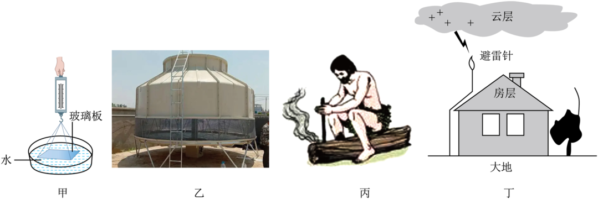

# Physics - 题目 42

**ID**: 1371b6f3b892481094058e76ed7f85b7
**年级**: Grade 9
**难度**: Easy
**题型**: Multiple-choice

## 题目
下列各图中的物理现象，其中解释错误的是（      ）​​​​​​​‌

## 解答

1. A．因为玻璃下表面和水接触，玻璃板与水分子之间存在作用力，当用力向上拉时，弹簧测力计要克服水分子间的作用力，所以拉力比玻璃板的重力要大，弹簧测力计示数在离开水面时比离开水面后大，该现象说明分子间存在引力，故A正确，不符合题意；
2. B．因为水的比热容较大，升高相同的温度，水吸收的热量多，所以工厂里的冷却池大多用水作为冷却介质，故B正确，不符合题意；
3. C．在古代，人类钻木取火，属于做功改变物体的内能，故C正确，不符合题意；
4. D．如图，云层带正电荷，避雷针工作时尖端放电，负电荷从大地定向移动到云层，根据正电荷定向移动的方向规定为电流的方向，所以避雷针中电流方向是从云层流向大地，故D错误，符合题意。

## 知识点

**中文**:
  - 做功改变物体内能
  - 分子间的作用力
  - 水的比热容的特点及应用
  - 电流的方向

**English**:
  - Changing Internal Energy by Doing Work
  - Intermolecular Forces
  - Characteristics and Applications of Water's Specific Heat
  - Direction of Electric Current

---
