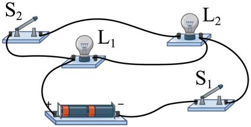

# Physics - 题目 2383

**ID**: 18c336dc240c4b6693df990d32ebaa32
**年级**: Grade 9
**难度**: Easy
**题型**: Multiple-choice

## 题目
图示电路中，当开关 ${\rm{S}}{{}_{{{1}}}}$ 、 ${\rm{S}}{{}_{{{2}}}}$ 均闭合后（      ）​​​​​​​‌

## 解答

1. 由电路图可知，当开关 ${\rm{S}}{{}_{{{1}}}}$ 、 ${\rm{S}}{{}_{{{2}}}}$ 均闭合后，L_{1}与L_{2}并联，则两个灯泡都能发光，故A符合题意，BCD不符合题意。

## 知识点

**中文**:
  - 串联电路和并联电路的辨别

**English**:
  - Distinguishing Series and Parallel Circuits

---
