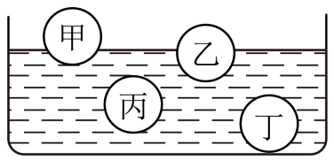

# Physics - 题目 2444

**ID**: 1da9eff95736435797b833fa9e421d88
**年级**: Grade 9
**难度**: Easy
**题型**: Multiple-choice

## 题目
体积相同而材料不同的小球甲、乙、丙、丁，静止在容器的水中，如图所示．这四个小球所受的浮力分别为F_{甲}、F_{乙}、F_{丙}、F_{丁}，则（      ）​​​​​​​‌

## 解答

1. 由图知，四个球排开水的体积V_{甲}＜V_{乙}＜V_{丙}=V_{丁}_{，}根据F_{浮}=ρ_{水}V_{排}g可知四个球受到的浮力F_{甲}＜F_{乙}＜F_{丙}=F_{丁}_{，}由此可知：B正确，ACD错误；

## 知识点

**中文**:
  - 阿基米德原理的应用

**English**:
  - Applications of Archimedes' Principle

---
