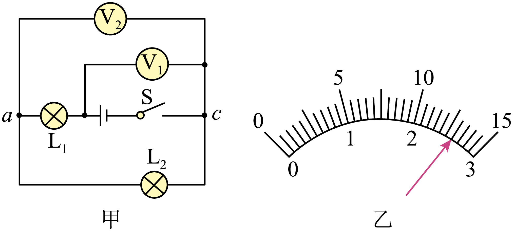

# Physics - 题目 2911

**ID**: 1f2ce02405164a72aec5daf8ec594255
**年级**: Grade 9
**难度**: Easy
**题型**: Multiple-choice

## 题目
如图甲所示电路中，V_{1}、V_{2}都是有0~3V和0~15V两个量程的电压表，闭合开关后，两个电压表指针偏转均如图乙所示，则灯泡L_{1}、L_{2}两端的电压为（      ）​​​​​​​‌

## 解答

1. 由电路图可知，灯泡L_{1}、L_{2}串联，电压表V_{1}测电源电压，电压表V_{2}测L_{2}两端的电压，因为串联电路两端电压等于各部分电压之和，所以电压表V_{1}的示数应大于V_{2}的示数，而两个电压表指针偏转均相同，则电压表V_{1}的量程是0~15V，分度值为0.5V，示数为13V，即电源电压U=13V；电压表V_{2}的量程是0~3V，分度值为0.1V，示数为2.6V，即L_{2}两端的电压U_{2}=2.6V；由串联电路的电压特点可知，L_{1}两端的电压为
2. U_{1}=U-U_{2}=13V-2.6V=10.4V
3. 故A符合题意，BCD不符合题意。
4. 故选A。

## 知识点

**中文**:
  - 串联电路的电压规律
  - 电压表的使用
  - 电压表的读数

**English**:
  - Voltage Law in Series Circuits
  - Using a Voltmeter
  - Reading a Voltmeter

---
