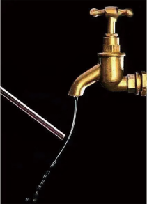

# Physics - 题目 1461

**ID**: 26df0e3b6b8d49dcbf7dfadf73538caa
**年级**: Grade 9
**难度**: Easy
**题型**: Multiple-choice

## 题目
用一根与毛皮摩擦过的橡胶棒靠近竖直向下的细小水流，发现水流发生弯曲，如图所示。​​​​​​​‌下列有关说法正确的是（      ）

## 解答

1. A．摩擦起电的实质，不是创造了电荷，而是电荷的转移，故A错误；
2. B．根据题意可知，橡胶棒带了电荷，带电体能够吸引轻小物体，所以能够吸引细小的水流，故B正确；
3. C．橡胶棒束缚电子本领比毛皮强，毛皮摩擦过的橡胶棒带负电，故C错误；
4. D．试电笔可以检验火线和零线，不能检验橡胶棒是否带电，故D错误。

## 知识点

**中文**:
  - 摩擦起电的实质
  - 验电器的原理及使用

**English**:
  - Nature of Triboelectricity
  - Principle and Use of Electroscope

---
