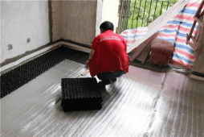

# Physics - 题目 2351

**ID**: 3725b65510044ab4a88cfaf126fb665d
**年级**: Grade 9
**难度**: Easy
**题型**: Multiple-choice

## 题目
如图所示，“水地暖”是在地面下安装散热管，用燃气壁挂炉加热，水在散热管中循环流动向地面散热，从而使房间暖和起来，这是利用水的较大的特性；用燃气壁挂炉将质量为2kg的水从20℃加热到50℃，水吸收的热量是J。​​​​​​​‌[已知水的比热容为 $4.2\times {\rm{1}}{\rm{0}}{^{{\rm{3}}}}{\rm{J}}{\rm{/}}\left ({{\rm{k}}{\rm{g}}\cdot ℃}\right )$ ]

## 解答

1. 因为水的比热容较大，和质量相同的其他物质相比，在降低相同温度时，水能放出更多的热量，所以这是利用水的比热容较大的特性。
2. 由题意可知，水的比热容为 $4.2\times {\rm{1}}{\rm{0}}{^{{\rm{3}}}}{\rm{J}}{\rm{/}}\left ({{\rm{k}}{\rm{g}}\cdot ℃}\right )$ ，水的质量为2kg，水的温度变化量， $\Delta t={\rm{5}}{\rm{0}}℃-{\rm{2}}{\rm{0}}℃={\rm{3}}{\rm{0}}℃$
3. 根据比热容公式可知，水吸收的热量， $Q{{}_{吸}}=c{{}_{水}}m{{}_{水}}\Delta t=4.2\times {\rm{1}}{\rm{0}}{^{{\rm{3}}}}{\rm{J}}{\rm{/}}\left ({{\rm{k}}{\rm{g}}\cdot ℃}\right )\times {\rm{2}}{\rm{k}}{\rm{g}}\times {\rm{3}}{\rm{0}}℃=2.52\times {\rm{1}}{\rm{0}}{^{{\rm{5}}}}{\rm{J}}$ ，水吸收的热量为 $2.52\times 1{\rm{0}}{^{{\rm{5}}}}{\rm{J}}$ 。

## 知识点

**中文**:
  - 比热容的概念及其计算
  - 水的比热容的特点及应用

**English**:
  - Concept and Calculation of Specific Heat Capacity
  - Characteristics and Applications of Water's Specific Heat

---
