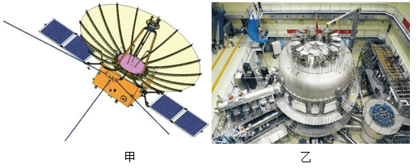

# Physics - 题目 882

**ID**: 3dc6db58f54b4963aa6934c33b76f60f
**年级**: Grade 9
**难度**: Easy
**题型**: Multiple-choice

## 题目
近年来我国的科技发展突飞猛进，特别是信息和能源方面取得了巨大的成就．如图甲是2018年5月21日发射的一颗探测月球背面卫星“鹊桥”．图乙是我国的“小太阴工程，它就是在高温下象太阳一样发生核反应，释放核能．关于“鹊桥”和“小太阳”说法中正确的是​​​​​​​‌

## 解答

1. 月球表面是真空，由于电磁波能在真空中传播，而超声波不能，所以“鹊桥”与地面之间的联系是靠电磁波，故A正确，B错误；根据题意知道，“我国的“小太阴工程，它就是在高温下象太阳一样发生核反应，释放核能”，由于太阳是通过核聚变来释放能量的，所以，“小太阳”发生着核聚变，故C错误；核能在地球是的储量是有限的，消耗后不可能再生，小太阳的核原料是属不可再生能源，故D错误，故选A．

## 知识点

**中文**:
  - 核裂变
  - 能源的分类
  - 电磁波的传播与应用

**English**:
  - Nuclear Fission
  - Classification of Energy Sources
  - Propagation and Application of Electromagnetic Waves

---
