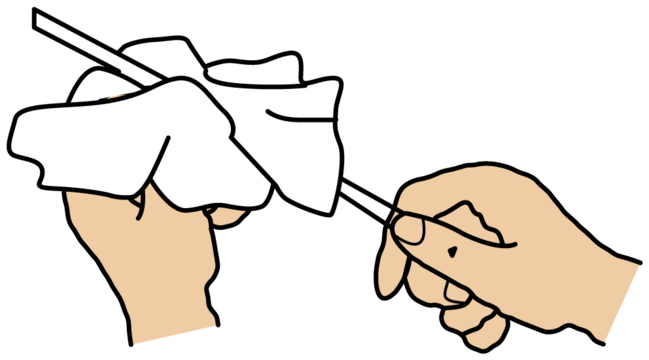

# Physics - 题目 1202

**ID**: 465bd46e1f9e4e74aa3c0cb995068724
**年级**: Grade 9
**难度**: Easy
**题型**: Multiple-choice

## 题目
如图所示，用丝绸与玻璃棒摩擦后，下列说法正确的是（      ）​​​​​​​‌

## 解答

1. AB．与丝绸摩擦过的玻璃棒带正电，是因为丝绸得到电子带负电，玻璃棒失去电子带正电，故A错误，B正确；
2. CD．玻璃棒和丝绸带上异种电荷，会相互吸引，故CD错误。

## 知识点

**中文**:
  - 摩擦起电
  - 电荷间的相互作用规律

**English**:
  - Triboelectricity / Charging by Friction
  - Interaction between Charges

---
