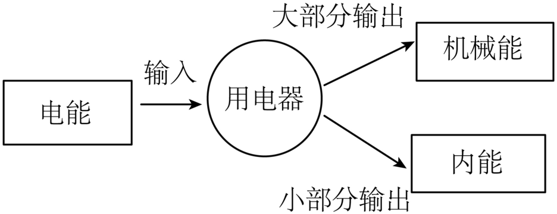

# Physics - 题目 2375

**ID**: 5852264a8b994e85856afaf7ca05348f
**年级**: Grade 9
**难度**: Easy
**题型**: Multiple-choice

## 题目
某用电器的能量流向图如图所示，由此可知该用电器可能是（      ）​​​​​​​‌

## 解答

1. 由图可知，该用电器工作时，少部分电能转化为内能，大部分电能转化为机械能。
2. AC．电饭煲和电热水器工作时，将全部电能转化为内能，故AC不符合题意；
3. B．白炽灯工作时，将部分电能转化为光能，部分电能转化为内能，故B不符合题意；
4. D．电风扇工作时，大部分电能转化为机械能，并产生少部分内能，故D符合题意。

## 知识点

**中文**:
  - 能量的转化

**English**:
  - Transformation of Energy

---
