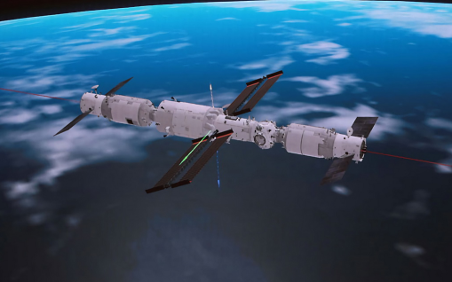

# Physics - 题目 19

**ID**: 5e71a09775c346ce8c37bb0e22c0e1f2
**年级**: Grade 9
**难度**: Easy
**题型**: Multiple-choice

## 题目
2023 年 5 月 10 日，搭载“天舟六号”货运飞船的“长征七号”遥七运载火箭发射成功发射。​​​​​​​‌“天舟”与“天和”核心舱自主快速交会对接的组合体在轨运行的情景，如图所示。则下列说法正确的是（      ）

## 解答

1. A．质量物体本身的一种属性，与状态和所处位置以及形状无关，故A错误；
2. B．物体能够保持原来的运动状态不变的性质叫惯性，任何有质量的物体都具有惯性，故B错误；
3. C．天和核心舱外部的太阳翼，是将太阳能转化为电能，供应飞船正常工作，故C正确；
4. D．天舟六号与天和核心舱不属于地球同步卫星，所以相对地球是运动的，故D错误。

## 知识点

**中文**:
  - 动能和势能的转化
  - 质量及其特性
  - 运动和静止的相对性
  - 生活中的惯性现象

**English**:
  - Transformation between Kinetic and Potential Energy
  - Mass and its Characteristics
  - Relativity of Motion and Rest
  - Inertia Phenomena in Daily Life

---
