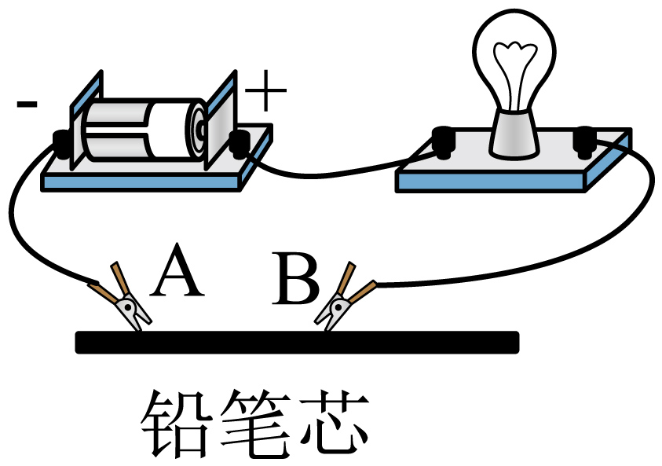

# Physics - 题目 2838

**ID**: 626443a875be4e0095e39da8fac07809
**年级**: Grade 9
**难度**: Easy
**题型**: Multiple-choice

## 题目
如图所示，用A、B两个金属夹子将一根铅笔芯接入电路中，当B夹子左右移动时，小灯泡的亮度会发生变化。​​​​​​​‌下列关于这一装置的说法中正确的是（      ）

## 解答

1. A．铅笔芯是导体，塑料吸管是绝缘体，把铅笔芯换成塑料吸管，电路没有接通，灯泡不会亮，故A错误；
2. B．接入电路的电阻越大，电路中的电流越小，灯泡会越暗，所以可以通过灯泡的亮暗反映接入电路的电阻大小，故B正确；
3. C．当B夹子左右移动时，铅笔芯接入电路的长度发生变化，导致接入电路的阻值发生变化，故C错误；
4. D．电阻是导体自身的一种性质，只与导体的材料、长度、横截面积、温度有关，与电压、电流无关，故D错误。
5. 故选B。

## 知识点

**中文**:
  - 影响电阻大小的因素

**English**:
  - Factors Affecting Resistance

---
