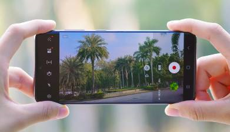

# Physics - 题目 1382

**ID**: 7c091a347dc343edabfaf727328ed2a7
**年级**: Grade 9
**难度**: Easy
**题型**: Multiple-choice

## 题目
如图所示，小明用手机摄像头给远处的树木拍风景照。​​​​​​​‌照相过程中下列说法中正确的是（      ）

## 解答

1. A．树木本身不发光，不是光源，故A错误；
2. B．树木在各个方向都能看到，其表面会发生漫反射，不是镜面反射，故B错误；
3. CD．摄像头相当于凸透镜，成倒立缩小实像，故C正确，D错误。

## 知识点

**中文**:
  - 光源
  - 镜面反射和漫反射
  - 生活中的透镜应用

**English**:
  - Light Sources
  - Specular and Diffuse Reflection
  - Lenses in Daily Life

---
