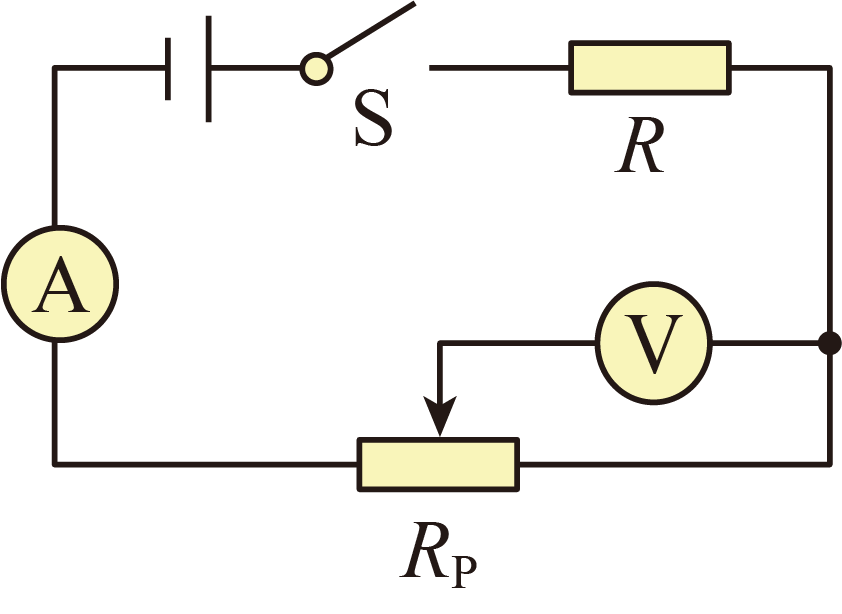

# Physics - 题目 2986

**ID**: 96916b32673147feb55f28e2c524d83f
**年级**: Grade 9
**难度**: Easy
**题型**: Multiple-choice

## 题目
在如图所示的电路中，电源电压恒定，当滑动变阻器 $R{{}_{{\rm{p}}}}$ 的滑片从最左端滑到最右端的过程中，下列说法正确的是（      ）​​​​​​​‌

## 解答

1. ABC．据图可知，电路是串联的，此时电压表串联在滑片P上，变阻器充当的是定值电阻，即电路为两定值电阻串联，电压表测 $R{{}_{{\rm{p}}}}$ 部分电阻两端电压，当滑动变阻器 $R{{}_{{\rm{p}}}}$ 的滑片从最左端滑到最右端的过程中，电路中的电流不变，电压表所测 $R{{}_{{\rm{p}}}}$ 部分阻值变小，根据 $U=IR$ 可知，电压表的示数变小，故AB错误，C正确；
2. D．电压表的示数与电流表的示数比值为电压表所测 $R{{}_{{\rm{p}}}}$ 部分的阻值，因此该比值会变小，故D错误。

## 知识点

**中文**:
  - 动态电路中电表示数的变化

**English**:
  - Changes in Meter Readings in Dynamic Circuits

---
