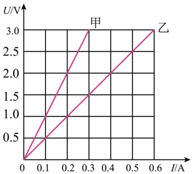

# Physics - 题目 2303

**ID**: 9b08be58b41f47978f9d26207ff9b466
**年级**: Grade 9
**难度**: Easy
**题型**: Multiple-choice

## 题目
甲、乙两个电阻的U-I图线如图所示，若把两个电阻串联接在同一电路中，下列说法正确的是（      ）​​​​​​​‌

## 解答

1. A．由图像可知，通过两电阻的电流与两端的电压成正比即两电阻是定值电阻，当U_{甲}=U_{乙}=3V
2. 时，I_{甲}=0.3A、I_{乙}=0.6A，根据 $I=\frac {U}{R}$ ，两电阻的阻值分别为 $R{{}_{甲}}=\frac {U{{}_{甲}}}{I{{}_{甲}}}=\frac {{\rm{3}}{\rm{V}}}{{\rm{0}}{\rm{.}}{\rm{3}}{\rm{A}}}=10{\rm{Ω}}$ ， $R{{}_{乙}}=\frac {U{{}_{乙}}}{I{{}_{乙}}}=\frac {{\rm{3}}{\rm{V}}}{{\rm{0}}{\rm{.}}{\rm{6}}{\rm{A}}}=5{\rm{Ω}}$ ，所以甲的电阻值大于乙的电阻值。故A错误；
3. B．把两个电阻串联接在同一电路中时，根据串联电路中各处的电流相等，所以通过甲、乙两个电阻的电流之比是1:1，故B错误；
4. C．根据U=IR甲、乙两个电阻两端电压 $\frac {U{{}_{甲}}}{U{{}_{乙}}}=\frac {IR{{}_{甲}}}{IR{{}_{乙}}}=\frac {R{{}_{甲}}}{R{{}_{乙}}}=\frac {{\rm{1}}{\rm{0}}{\rm{Ω}}}{{\rm{5}}{\rm{Ω}}}=\frac {2}{1}$ ，故C正确；
5. D．根据P=I^{2}R，甲、乙两个电阻的电功率之比 $\frac {P{{}_{甲}}}{P{{}_{乙}}}=\frac {I{^{2}}R{{}_{甲}}}{I{^{2}}R{{}_{乙}}}=\frac {R{{}_{甲}}}{R{{}_{乙}}}=\frac {{\rm{1}}{\rm{0}}{\rm{Ω}}}{{\rm{5}}{\rm{Ω}}}=\frac {2}{1}$ ，故D错误。

## 知识点

**中文**:
  - 串联电路的电流规律
  - 并联电路的电压规律
  - 欧姆定律的应用

**English**:
  - Current Law in Series Circuits
  - Voltage Law in Parallel Circuits
  - Applications of Ohm's Law

---
