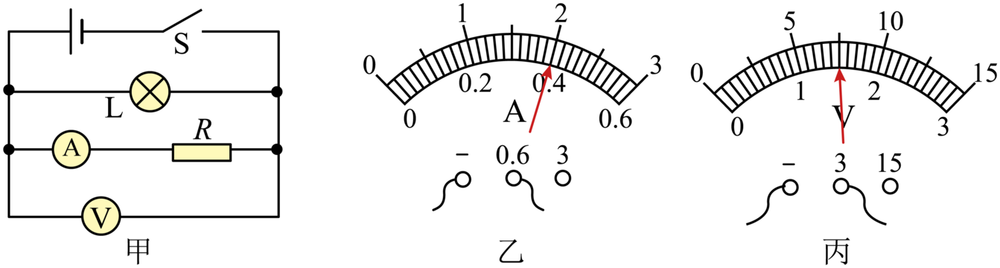

# Physics - 题目 2029

**ID**: a009d54f8a434345b8577dda167741a6
**年级**: Grade 9
**难度**: Easy
**题型**: Multiple-choice

## 题目
如图甲所示电路，闭合开关 ${\rm S}$ ，电流表和电压表的示数如图乙和丙所示，下列分析正确的是（      ）​​​​​​​‌

## 解答

1. A．由图甲可知，电流从电源正极流出后，分别经过灯 ${\rm{L}}$ 和“电流表、电阻R”支路，然后汇合回到电源负极，所以灯 ${\rm{L}}$ 与电阻R是并联，故A错误；
2. B．根据并联电路电阻特点，并联电路总电阻小于其中任何一个分电阻；电阻R是其中一个分电阻，所以电路的总电阻小于电阻R的阻值，故B错误；
3. C．电流表使用的是 $0\sim 0.6{\rm{A}}$ 量程，分度值为0.02A，其示数为0.40A，因为电流表测电阻R支路的电流，所以通过电阻R的电流是0.40A，故C正确；
4. D．电压表使用的是 $0\sim 3{\rm{V}}$ 量程，分度值为0.1V，其示数为1.5V。在并联电路中，各支路两端电压相等且等于电源电压，所以电源电压为1.5V，故D错误。

## 知识点

**中文**:
  - 串联电路和并联电路的辨别
  - 电流表的读数
  - 电压表的读数
  - 并联电路的电压规律
  - 电阻的并联

**English**:
  - Distinguishing Series and Parallel Circuits
  - Reading an Ammeter
  - Reading a Voltmeter
  - Voltage Law in Parallel Circuits
  - Parallel Connection of Resistors

---
