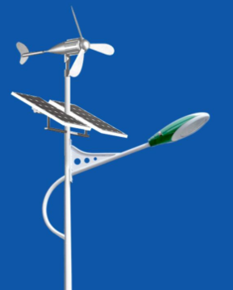

# Physics - 题目 1810

**ID**: a6c16e3d561f4c65a86f6b730a31473d
**年级**: Grade 9
**难度**: Easy
**题型**: Multiple-choice

## 题目
公路上使用的“风光互补”照明系统同时安装有风力发电机和太阳能电池板，如图所示。​​​​​​​‌该系统可以将风力发电机或太阳能电池板提供的电能储存至蓄电池中，供路灯照明使用。下列说法正确的是（      ）

## 解答

1. A．风力发电机是将机械能转化为电能的，故A错误；
2. B．太阳能电池板工作时将太阳能转化为电能，故B错误；
3. C．蓄电池对外供电时将储存的化学能转化为电能，故C错误；
4. D．路灯工作时消耗电能，获昨光能，是将电能转化为光能。故D正确。

## 知识点

**中文**:
  - 能量的转化

**English**:
  - Transformation of Energy

---
