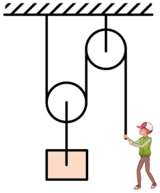

# Physics - 题目 607

**ID**: a6ec4c679a954a3ba67f399d35cf3861
**年级**: Grade 9
**难度**: Easy
**题型**: Multiple-choice

## 题目
一名体重500N的举重运动员，可举起1200N的物体，这个人站在地面上，用如图的装置提升重物，滑轮重和摩擦均忽略不计，在下列四个不同重力的物体中，他能提起最重的物重是（      ）​​​​​​​‌

## 解答

1. 根据题意知道，人的体重为500N，故人能施加的最大拉力F=500N，由图知道，该装置绳子的有效股数为2，所以 $F=\frac {1}{n}G=\frac {1}{2}G$ ，又因为滑轮重和摩擦均忽略不计，所以，他能提起最重的物重G=2F=2×500N=1000N，故D正确。

## 知识点

**中文**:
  - 动滑轮拉力的计算
  - 定滑轮及其工作特点

**English**:
  - Calculating Pulling Force of Movable Pulleys
  - Fixed Pulleys and Operating Characteristics

---
