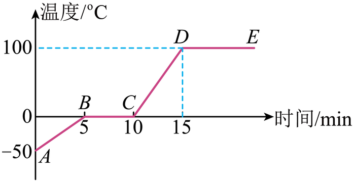

# Physics - 题目 2281

**ID**: ab348927f20a44559e92cbcac044924d
**年级**: Grade 9
**难度**: Easy
**题型**: Multiple-choice

## 题目
如图所示，该图像表示的是将某固体物质在1个标准大气压下加热的过程中，温度随时间变化的图像，则下列说法中错误的是（      ）​​​​​​​‌

## 解答

1. A．从图像中可以看出该物质有固定的熔点，即0℃，因此这种物质是晶体，故A正确，不符合题意；
2. B．由图像可知，BC段是物质熔化过程，此过程中为固液共存状态，故B正确，不符合题意；
3. C．由图像可知，该物质从5min开始熔化，到10min结束，熔化过程经历了5min，故C错误，符合题意；
4. D．由图像可知，BC段是物质熔化过程，此时温度是0℃，即该物质的熔点是0℃，即凝固点为0℃，DE段表示物质沸腾过程，此时温度是100℃，因此在1个标准大气压下，该物质的沸点是100℃，故D正确，不符合题意。

## 知识点

**中文**:
  - 晶体和非晶体的区别
  - 熔化与熔化吸热的特点
  - 熔点和凝固点
  - 沸点及沸点与气压的关系

**English**:
  - Difference between Crystals and Amorphous Solids
  - Melting and Heat Absorption
  - Melting Point and Freezing Point
  - Boiling Point and Air Pressure

---
