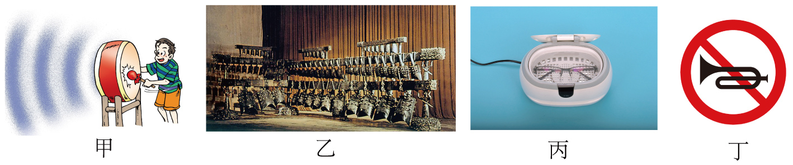

# Physics - 题目 1653

**ID**: afc15ab3af384267a8d0a67e9ab21376
**年级**: Grade 9
**难度**: Easy
**题型**: Multiple-choice

## 题目
关于声现象，下列说法正确的是（      ）​​​​​​​‌

## 解答

1. A．敲击鼓面，鼓面的振动带动周围的空气振动，形成了疏密相间的波动，向远处传播，故A错误；
2. B．用不同大小的力敲击同一个编钟，能发出不同的响度，故B正确；
3. C．超声波清洗机利用超声波可以传递能量，故C错误；
4. D．禁止鸣笛能有效地从声源处阻断噪声，故D错误。

## 知识点

**中文**:
  - 区分音调、响度与音色
  - 声音的产生和声源
  - 超声波的应用
  - 防治噪声的途径

**English**:
  - Distinguishing Pitch, Loudness, and Timbre
  - Sound Production and Sound Sources
  - Applications of Ultrasound
  - Methods of Noise Control

---
