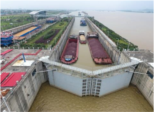

# Physics - 题目 304

**ID**: b6cbe068c4cf429ebcbc54402ce2d290
**年级**: Grade 9
**难度**: Easy
**题型**: Multiple-choice

## 题目
2023年10月10日，湘江长沙综合枢纽船闸运营满11周年，通过船舶622380万艘次，总货运通过量8.23亿吨，大力推动了湖南水运物流的发展。​​​​​​​‌下列与船闸工作原理相同的是（      ）

## 解答

1. 船闸是利用连通器原理工作的。
2. A．拦河大坝是利用液体压强的特点工作，液体深度越大，压强越大，所以大坝底部建得比上方宽，故A不正确；
3. B．活塞式抽水机是利用大气压将水压进抽水机的，故B不正确；
4. C．液体压强计上端有一端不是开口的，不是利用连通器工作的，故C不正确；
5. D．锅炉的上端开口，下端连通是利用连通器工作的，故D正确。

## 知识点

**中文**:
  - 连通器原理

**English**:
  - Principle of Communicating Vessels

---
