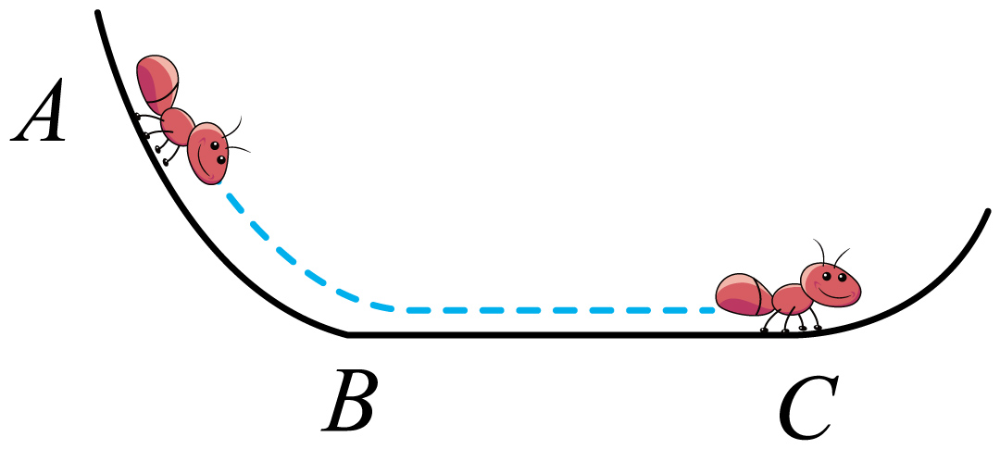

# Physics - 题目 2935

**ID**: ba13091645ee42e3bc39b255c1a54359
**年级**: Grade 9
**难度**: Easy
**题型**: Multiple-choice

## 题目
如图，蚂蚁从A处经B处爬到C处的过程，蚂蚁重力的大小（      ）​​​​​​​‌

## 解答

1. 重力是由于地球的吸引而使物体受到的力，重力的方向竖直向下，由 $G=mg$ 可得，物体受到的重力的大小跟物体的质量成正比，所以蚂蚁沿着碗从A点爬到C点过程中，蚂蚁质量没有变，所以受到的重力也没变，故A符合题意，BCD不符合题意。

## 知识点

**中文**:
  - 重力公式的应用

**English**:
  - Application of Gravity Formula

---
