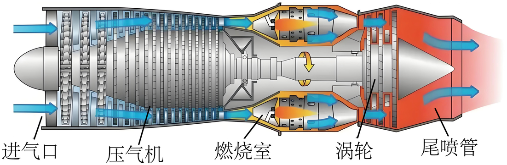

# Physics - 题目 1769

**ID**: c7e0bf71054d406881674d4b1dba6727
**年级**: Grade 9
**难度**: Easy
**题型**: Multiple-choice

## 题目
涡轮喷气发动机的基本结构如图所示。​​​​​​​‌工作时，空气通过进气口进入压气机被压缩，再进入燃烧室与燃料混合后燃烧，产生的高温高压燃气推动涡轮转动并从尾喷管高速喷出，从而获得动力。下列有关说法正确的是（      ）

## 解答

1. A．热值是燃料的一种特性，它只与燃料的种类有关，与燃料燃烧放出热量的多少无关，A错误；
2. B．燃料燃烧越充分，燃料放出的热量越多，用来做有用功的能量占燃料完全燃烧放出能量的比例越大，喷气发动机的效率越高，B错误；
3. C．高温高压燃气推动涡轮转动的过程，是内能转化为机械能的过程，内燃机的做功冲程也是将内能转化为机械能，所以该过程相当于内燃机的做功冲程，C正确；
4. D．燃气从尾喷管喷出获得动力的过程，是内能转化为机械能，其内能减小，D错误。

## 知识点

**中文**:
  - 做功改变物体内能
  - 热值及相关计算
  - 内燃机的四个冲程
  - 有关热机效率的计算

**English**:
  - Changing Internal Energy by Doing Work
  - Calorific Value and Calculations
  - Four Strokes of Internal Combustion Engines
  - Calculations of Heat Engine Efficiency

---
