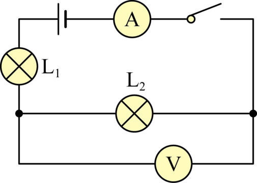

# Physics - 题目 1063

**ID**: cebb2e503f71444cbff8729dd295398c
**年级**: Grade 9
**难度**: Easy
**题型**: Multiple-choice

## 题目
如图所示电路，当开关闭合，两灯正常发光．使用中发现两灯突然熄灭，电流表无示数，电压表示数增大，则故障可能是​​​​​​​‌

## 解答

1. 首先分析电路，此电路是串联，电压表测量灯泡L_{2}当使用中发现两灯突然熄灭，说明是断路，电压表示数增大，则故障可能是电压表并联的L_{2}断路了，正确选D．

## 知识点

**中文**:
  - 电流表、电压表在判断电路故障中的应用

**English**:
  - Using Meters to Diagnose Circuit Faults

---
