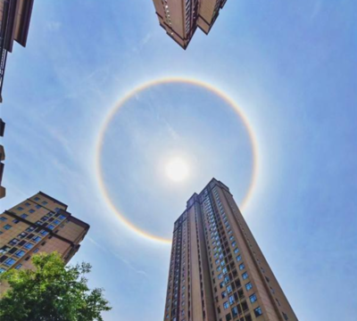

# Physics - 题目 2

**ID**: d58589471a504c1baa359b9f78dfb0ca
**年级**: Grade 9
**难度**: Easy
**题型**: Multiple-choice

## 题目
2023年5月13日，武汉上空惊现美丽的日晕现象，太阳旁边出现一圈彩虹光环。​​​​​​​‌这个美丽的奇观是由于在5000到6000米的高空中，出现了由冰晶构成的卷层云，云层中冰晶含量较大，阳光产生折射后形成的。下列现象与日晕形成原因相同的是（      ）

## 解答

1. 日晕是卷云层中冰晶含量较大，阳光产生折射后形成的。
2. A．手影游戏，影子是由于光的直线传播形成的，故A不符合题意；
3. B．对镜画妆，镜中的像是由于光的反射形成的，故B不符合题意；
4. C．海市蜃楼是由于光在不均匀的空气中传播时发生折射形成的，故C符合题意；
5. D．塔式太阳能电站利用光的反射来会聚太阳光，故D不符合题意。

## 知识点

**中文**:
  - 光的折射现象

**English**:
  - Phenomenon of Refraction

---
