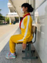

# Physics - 题目 2588

**ID**: d854c1f1b5e94effbc61c64a7073e2dc
**年级**: Grade 9
**难度**: Easy
**题型**: Multiple-choice

## 题目
如图小愿景坐在椅子，当她想站起来的时候，必须要靠脊椎弯腰将身体前倾使重心落在双脚的上方才能顺利地的站起来。​​​​​​​‌现在只要用一根手指作用在她的身上，就可以阻止她的前倾动作，她就很难站起来了。你觉得作用效果最好的是 （      ）

## 解答

1. 人要站起来，重心要落在双脚，支撑起身体；那是靠往前倾的动作，或者脚稍往后缩，施力点放前面才可站起来；如果额头被对方手指顶住，重心落在屁股上，全身就使不出力站起来。所以手指水平向右压在额头上作用效果最好。故ABC不符合题意，D符合题意。
2. 故选D。

## 知识点

**中文**:
  - 重心

**English**:
  - Center of Gravity

---
