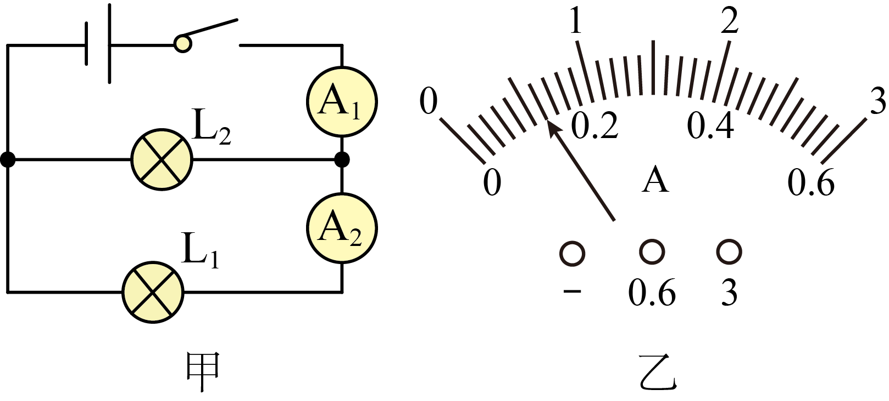

# Physics - 题目 842

**ID**: d8a8def8010c49e285da7eb0d47f34e0
**年级**: Grade 9
**难度**: Easy
**题型**: Multiple-choice

## 题目
如图甲所示，闭合开关后，两灯均发光，灯泡L_{1}比L_{2}亮，已知电流表A_{2}的示数为0.​​​​​​​‌2A，电流表A_{1}的示数如图乙，下列说法正确的是（      ）

## 解答

1. 两灯并联，电流表A_{1}在干路中，测干路中的电流，电流表A_{2}与灯L_{1}串联，测量灯L_{1}的电流，所以流过L_{1}的电流是0.2A，而电流表A_{1}在干路中，示数应该按照0~3A的量程读，为0.6A，根据并联电路的电流特点知：L_{2}的电流为
2. $I{{}_{2}}=I-I{{}_{1}}=0.6{\rm{A}}-0.2{\rm{A}}=0.4{\rm{A}}$
3. 由以上分析可知，ACD错误，B正确。
4. 故选B。

## 知识点

**中文**:
  - 并联电路的电流规律
  - 电流表量程的选择

**English**:
  - Current Law in Parallel Circuits
  - Choosing Ammeter Range

---
