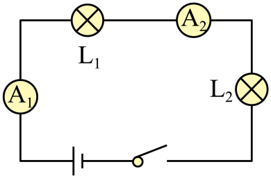

# Physics - 题目 2418

**ID**: e3347682ed614cc9983b1d619599009a
**年级**: Grade 9
**难度**: Easy
**题型**: Multiple-choice

## 题目
在探究串联电路电流特点时，闭合开关后，发现电流表 ${\rm{A}}{{}_{1}}$ 和 ${\rm{A}}{{}_{2}}$ 的示数分别为 $0.​​​​​​​‌28{\rm{A}}$ 和 $0.26{\rm{A}}$ ，造成该现象的原因可能是（      ）

## 解答

1. 在探究串联电路电流特点时，闭合开关后，发现电流表 ${\rm{A}}{{}_{1}}$ 和 ${\rm{A}}{{}_{2}}$ 的示数分别为 $0.28{\rm{A}}$ 和 $0.26{\rm{A}}$ ，造成该现象的原因可能是电流表没有调零，出现误差，故D符合题意，ABC不符合题意。

## 知识点

**中文**:
  - 串联电路的电流规律
  - 电流表的使用

**English**:
  - Current Law in Series Circuits
  - Using an Ammeter

---
