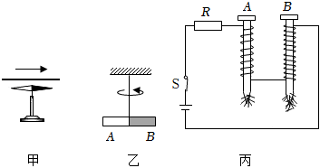

# Physics - 题目 355

**ID**: ec0720618e954170a141d11a02b42517
**年级**: Grade 9
**难度**: Easy
**题型**: Multiple-choice

## 题目
关于图中实验的说法正确的是（      ）​​​​​​​‌

## 解答

1. A．该图所示实验是奥斯特实验，说明通电导体周围存在磁场，故A正确；
2. B．磁体都具有指向性，图中条形磁铁静止时B端总是指向地理的北方，说明B端是条形磁铁的北极，故B错误；
3. CD．由图知，两电磁铁串联，则通过的电流大小相同，只有线圈的匝数不同，且吸引大头针的数量不同，说明电磁铁磁性强弱与线圈匝数是有关系的，而电流从下端内侧流处A电磁铁，根据安培定则，下端为N极，故C、D错误。

## 知识点

**中文**:
  - 地磁场
  - 影响电磁铁磁性强弱的因素
  - 安培定则及其应用

**English**:
  - Geomagnetic Field
  - Factors Affecting Electromagnet Strength
  - Ampere's Rule and Applications

---
