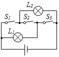

# Physics - 题目 2261

**ID**: fbe5fca54bf04e3d89d8aa11d492dcce
**年级**: Grade 9
**难度**: Easy
**题型**: Multiple-choice

## 题目
如图所示的电路，要使两个小灯泡L_{1}，L_{2}串联，应（      ）​​​​​​​‌

## 解答

1. 要使两个小灯泡L_{1}，L_{2}串联，电流从正极开始，依次经过灯泡L_{1}、S_{2}、L_{2}回到电源负极，因此断开开关S_{1}，S_{3}，闭合开关S_{2}。

## 知识点

**中文**:
  - 串联电路和并联电路的辨别

**English**:
  - Distinguishing Series and Parallel Circuits

---
