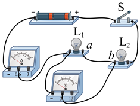

# Physics - 题目 1899

**ID**: ff9eacd7b6bc47428f40dff80490c4cf
**年级**: Grade 9
**难度**: Easy
**题型**: Multiple-choice

## 题目
如图所示的电路中，电源由两节新的电池组成，两个灯泡的额定电压相同，灯L_{1}的电阻比灯L_{2}的电阻小很多。​​​​​​​‌闭合开关S后，可能观察到的现象是（      ）

## 解答

1. AB．由图可知，两个灯泡串联，电压表测量L_{1}两端的电压，电流表测量电路中的电流，串联电路中各处的电流相等，灯L_{1}的电阻比灯L_{2}的电阻小很多，由P=I^{2}R可知，灯L_{1}的实际功率较小，L_{1}比L_{2}暗，由U=IR可知，灯L_{1}的电压较小，电压表的示数较小，故A不符合题意，B符合题意；
2. CD．若导线ab断路，电压表串联在电路中，由于电压表内阻很大，电压表的示数接近电源电压，通过电路的电流很小，电流表的示数为零，故CD不符合题意。
3. 故选B。

## 知识点

**中文**:
  - 欧姆定律的应用
  - 电功率的计算及应用

**English**:
  - Applications of Ohm's Law
  - Calculation and Application of Electric Power

---
