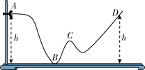

# Physics - 题目 92

**ID**: 24bb68d1e7b84309bf8a7ea0ad9d3c1e
**年级**: Grade 9
**难度**: Easy
**题型**: Multiple-select

## 题目
如图所示，小球沿轨道由静止从A点向D点运动的过程中(小球和轨道间存在摩擦)，下列说法正确的是（      ）​​​​​​​‌

## 解答

1. AD．因为小球需要克服摩擦做功，在运动过程中有一部分机械能转化为内能，故小球不能到达D点，所以小球在A时，高度最高，重力势能最大，故A项正确，D项正确；
2. B．小球在B点时，小球的质量不变，高度最小，势能最小，动能最大，速度最大，故B项正确；
3. C．因为小球和轨道间存在摩擦，小球需要克服摩擦做功，故小球从B点到C点的机械能减小，故C项错误。
4. 故选ABD。

## 知识点

**中文**:
  - 动能的变化问题
  - 重力势能的变化问题
  - 机械能的变化问题

**English**:
  - Changes in Kinetic Energy
  - Changes in Gravitational Potential Energy
  - Changes in Mechanical Energy

---
