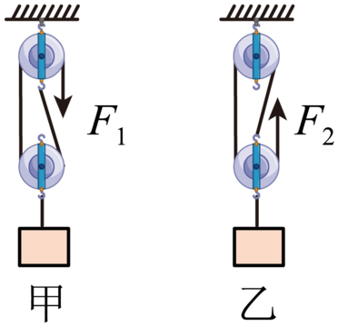

# Physics - 题目 2214

**ID**: 7b8ef74a4989466a970ae2600a81dfdc
**年级**: Grade 9
**难度**: Easy
**题型**: Multiple-select

## 题目
如图所示，用相同的滑轮组装成甲、乙滑轮组，分别将同一重物在相等的时间内提升相同的高度，不计绳重和摩擦，则​​​​​​​‌

## 解答

1. A.由图像可知甲中绳子股数n_{甲}=2，乙中绳子股数n_{乙}=3，拉起相同的重物，因此甲的拉力大小为 $F{{}_{甲}}=\frac {1}{2}\left ({G+G{{}_{动}}}\right )$ ，乙拉力的大小为 $F{{}_{乙}}=\frac {1}{3}\left ({G+G{{}_{动}}}\right )$ ，则甲、乙的拉力之比是3:2，A正确；
2. B.物体上升的速度相同，由滑轮组特点可知，甲绳的自由端速度 $v{{}_{甲}}{\rm{=}}2v{{}_{物}}$ ，乙绳的自由端速度 $v{{}_{乙}}{\rm{=}}3v{{}_{物}}$ ，则甲、乙绳的自由端速度之比是2:3，B错误；
3. C.由选项AB可知甲乙拉力值比为3:2，绳的自由端速度之比是2:3，根据公式 $P=Fv$ 可知甲、乙拉力的功率之比是1:1，C错误；
4. D.由公式 $η=\frac {W{{}_{有}}}{W{{}_{总}}}=\frac {Gh}{Fs}=\frac {Gh}{\frac {1}{n}\left ({G+G{{}_{动}}}\right )\times nh}=\frac {G}{G+G{{}_{动}}}$ 可知机械效率只与物重和动滑轮重有关，甲乙两组中，物重相等，动滑轮重相等，因此机械效率之比是1:1，D正确．

## 知识点

**中文**:
  - 功率的计算和估算
  - 滑轮组及其工作特点
  - 滑轮组绳子拉力的计算
  - 滑轮（组）的机械效率及其计算

**English**:
  - Calculation and Estimation of Power
  - Pulley Systems and Operating Characteristics
  - Calculating Rope Tension in Pulley Systems
  - Mechanical Efficiency of Pulleys and Calculations

---
