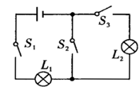

# Physics - 题目 439

**ID**: 7f4ec3fb238d447f8e44ff5227e3f300
**年级**: Grade 9
**难度**: Easy
**题型**: Multiple-select

## 题目
在下图所示的电路中，开关S_{1}，S_{3}闭合时，两灯泡都发光，当再闭合开关S_{2}时，则有（      ）​​​​​​​‌

## 解答

1. 由题意，开关S_{1}，S_{3}闭合时，两灯泡为串联。当再闭合开关S_{2}时，开关S_{2}将灯L_{2}短路，L_{2}由起初的发光变成不发光，灯泡L_{1}会比原来变亮。
2. 故选AC。

## 知识点

**中文**:
  - 串、并联电路中短路和断路的分析
  - 通路、断路和短路

**English**:
  - Analysis of Short and Open Circuits
  - Closed, Open, and Short Circuits

---
