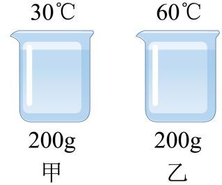

# Physics - 题目 2782

**ID**: cb725cb58ffd4e80a478f042e0eace12
**年级**: Grade 9
**难度**: Easy
**题型**: 自我评价与作业

## 题目
仔细观察图中甲、乙两杯水。​​​​​​​‌下列说法正确的是（      ）

## 解答

1. 由图可知，甲和乙杯中水的质量相同，但乙杯中水的温度高于甲杯，因为在质量相同的情况下，物体的温度越高，物体的内能越大，所以乙杯中水的内能大，故B正确，ACD错误。
2. 故选B。

## 知识点

**中文**:
  - 内能的概念

**English**:
  - Concept of Internal Energy

---
