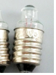

# Physics - 题目 539

**ID**: 11ef027b00a54f4ebaf78c34714ebf94
**年级**: Grade 9
**难度**: Easy
**题型**: Short Answer

## 题目
如图所示是医用笔形手电筒的小灯泡，它的玻璃泡前部中央厚，边缘薄，请你解释这样做的物理道理：。​​​​​​​‌

## 解答

1. 中央厚边缘薄构成了一个玻璃凸透镜，灯丝位于该凸透镜的焦点上，发出的发散光线经过凸透镜汇聚后平行于主光轴射出，能够射得远，光线集中、强度大。

## 知识点

**中文**:
  - 凸透镜的会聚作用

**English**:
  - Converging Effect of Convex Lenses

---
