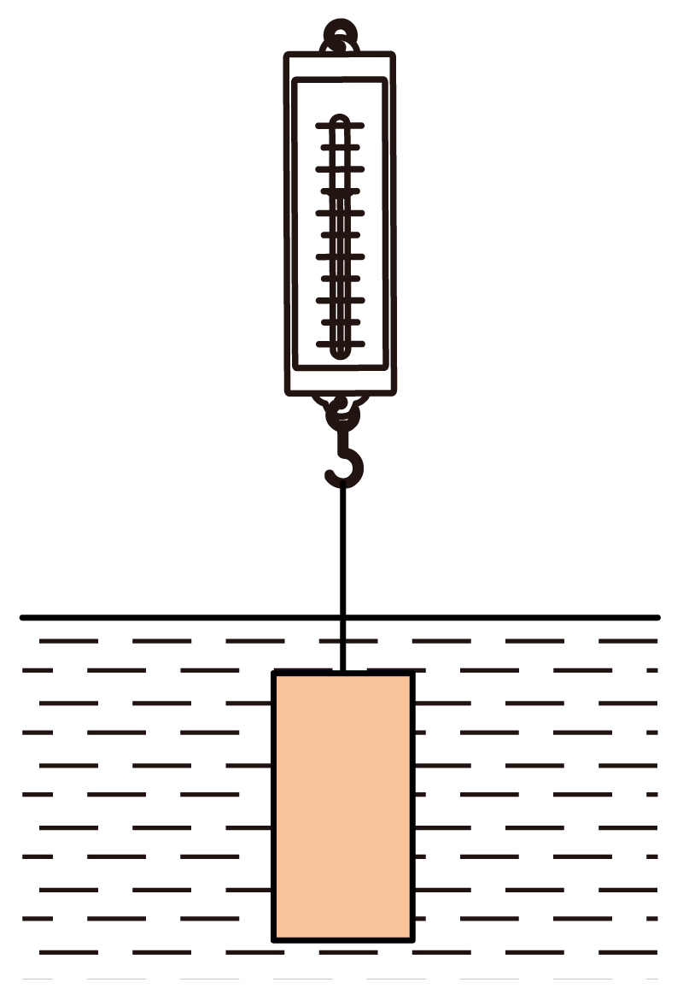

# Physics - 题目 2941

**ID**: 0340f04cc9d74c36ac9deaa42a7e0083
**年级**: Grade 9
**难度**: Hard
**题型**: Calculation

## 题目
一个不吸收液体的圆柱体重5N，底面积 $S{{}_{1}}=2.5\times 10{^{-3}}{\rm{m}}{^{2}}$ 。​​​​​​​‌如图所示，将圆柱体浸没在水中，弹簧测力计的示数为3N，已知 $ρ{{}_{{\rm{水}}}}=1.0\times 10{^{3}}{\rm{k}}{\rm{g}}{\rm{/}}{\rm{m}}{^{3}}$ ，取g=10N/kg。（1）求圆柱体浸没在水中时受到的浮力 $F{{}_{{\rm{浮}}}}$ ；（2）将圆柱体竖直放在水平桌面上，求圆柱体对水平桌面的压强p；（3）一个足够高的柱形容器放在水平桌面上，装入某种液体后，液体对容器底部的压强为 $p{{}_{1}}$ 。再将圆柱体缓慢地放入容器中，圆柱体始终保持竖直，松开后最终液面与圆柱体顶部的距离d=2cm，液体对容器底部的压强为 $p{{}_{2}}$ 。已知 $p{{}_{2}}-p{{}_{1}}=180{\rm{P}}{\rm{a}}$ ，容器底面积 $S{{}_{2}}=100{\rm{c}}{\rm{m}}{^{2}}$ 。求容器中液体的质量。

## 解答

1. 解：（1）圆柱体重5N，将圆柱体浸没在水中，弹簧测力计的示数为3N，在水中时受到的浮力为
2. $F{{}_{{\rm{浮}}}}{\rm{=}}G-F{{}_{示}}{\rm{=}}5{\rm{N}}-3{\rm{N}}=2{\rm{N}}$
3. （2）圆柱体重5N，底面积 $S{{}_{1}}=2.5\times 10{^{-3}}{\rm{m}}{^{2}}$ ，竖直放在水平桌面上，对底部的压力大小等于重力大小，则圆柱体对水平桌面的压强为
4. $p=\frac {F}{S{{}_{1}}}=\frac {G}{S{{}_{1}}}=\frac {5{\rm{N}}}{2.5\times 10{^{-3}}{\rm{m}}{^{{\rm{2}}}}}=2000{\rm{P}}{\rm{a}}$
5. （3）将圆柱体浸没在水中，受到的浮力 $F{{}_{{\rm{浮}}}}$ 为2N，则圆柱体体积为
6. $V{\rm{=}}V{{}_{排}}{\rm{=}}\frac {F{{}_{浮}}}{ρ{{}_{水}}g}=\frac {2{\rm{N}}}{1\times 10{^{3}}{\rm{k}}{\rm{g}}{\rm{/}}{\rm{m}}{^{{\rm{3}}}}\times 10{\rm{N}}{\rm{/}}{\rm{k}}{\rm{g}}}=2\times 10{^{-4}}{\rm{m}}{^{3}}$
7. 圆柱体密度为
8. $ρ{\rm{=}}\frac {G}{gV}=\frac {5{\rm{N}}}{10{\rm{N}}{\rm{/}}{\rm{k}}{\rm{g}}\times 2\times 10{^{-4}}{\rm{m}}{^{3}}}=2.5\times 10{^{3}}{\rm{k}}{\rm{g}}/{\rm{m}}{^{3}}$
9. 圆柱体高度为
10. $h=\frac {V}{S{{}_{1}}}=\frac {2\times 10{^{-4}}{\rm{m}}{^{3}}}{2.5\times 10{^{-3}}{\rm{m}}{^{2}}}=0.08{\rm{m}}=8{\rm{c}}{\rm{m}}$
11. ①若圆柱体漂浮在液面上时，液面与圆柱体顶部的距离d=2cm，此时液面上升的高度为
12. $Δh{{}_{1}}=\frac {V{{}_{排}}}{S{{}_{2}}}=\frac {(0.08{\rm{m}}-0.02{\rm{m}})\times 2.5\times 10{^{-3}}{\rm{m}}{^{{\rm{2}}}}}{1\times 10{^{-2}}{\rm{m}}{^{{\rm{2}}}}}=0.015{\rm{m}}$
13. 已知 $p{{}_{2}}-p{{}_{1}}=180{\rm{P}}{\rm{a}}$ ，则根据 $Δp=ρ{{}_{液}}gΔh$ 可知，液体密度为
14. $ρ{{}_{液}}{\rm{=}}\frac {Δp}{gΔh}=\frac {180{\rm{P}}{\rm{a}}}{10{\rm{N}}{\rm{/}}{\rm{k}}{\rm{g}}\times 0.015{\rm{m}}}=1.2\times 10{^{3}}{\rm{k}}{\rm{g}}/{\rm{m}}{^{3}}<2.5\times 10{^{3}}{\rm{k}}{\rm{g}}/{\rm{m}}{^{3}}$
15. 液体密度小于物体密度，故圆柱体不可能漂浮，只能沉底。
16. ②若圆柱体沉底，但只有部分浸没，液面与圆柱体顶部的距离d=2cm，此时液面上升的高度为
17. $Δh{{}_{1}}=\frac {V{{}_{排}}}{S{{}_{2}}}=\frac {(0.08{\rm{m}}-0.02{\rm{m}})\times 2.5\times 10{^{-3}}{\rm{m}}{^{{\rm{2}}}}}{1\times 10{^{-2}}{\rm{m}}{^{{\rm{2}}}}}=0.015{\rm{m}}$
18. 已知 $p{{}_{2}}-p{{}_{1}}=180{\rm{P}}{\rm{a}}$ ，则根据 $Δp=ρ{{}_{液}}gΔh$ 可知，液体密度为
19. $ρ{{}_{液}}{\rm{=}}\frac {Δp}{gΔh{{}_{1}}}=\frac {180{\rm{P}}{\rm{a}}}{10{\rm{N}}{\rm{/}}{\rm{k}}{\rm{g}}\times 0.015{\rm{m}}}=1.2\times 10{^{3}}{\rm{k}}{\rm{g}}/{\rm{m}}{^{3}}<2.5\times 10{^{3}}{\rm{k}}{\rm{g}}/{\rm{m}}{^{3}}$
20. 与题意相符，且此时装有液体的体积为
21. $V{{}_{液}}{\rm{=}}1\times 10{^{-2}}{\rm{m}}{^{{\rm{2}}}}\times (0.08{\rm{m}}-0.02{\rm{m}})-(0.08{\rm{m}}-0.02{\rm{m}})\times 2.5\times 10{^{-3}}{\rm{m}}{^{{\rm{2}}}}=4.5\times 10{^{-4}}{\rm{m}}{^{{\rm{3}}}}$
22. 则容器中液体的质量为
23. $m{{}_{液}}{\rm{=}}ρ{{}_{液}}V{{}_{液}}{\rm{=}}1.2\times 10{^{3}}{\rm{k}}{\rm{g}}/{\rm{m}}{^{3}}\times 4.5\times 10{^{-4}}{\rm{m}}{^{{\rm{3}}}}{\rm{=}}0.54{\rm{k}}{\rm{g}}$
24. ③若圆柱体沉底，且全部浸没，液面与圆柱体顶部的距离d=2cm，此时液面上升的高度为
25. $Δh{{}_{2}}=\frac {V}{S{{}_{2}}}=\frac {2\times 10{^{-4}}{\rm{m}}{^{{\rm{3}}}}}{1\times 10{^{-2}}{\rm{m}}{^{{\rm{2}}}}}=0.02{\rm{m}}$
26. 已知 $p{{}_{2}}-p{{}_{1}}=180{\rm{P}}{\rm{a}}$ ，则根据 $Δp=ρ{{}_{液}}gΔh$ 可知，液体压强为
27. $ρ{{}_{液2}}{\rm{=}}\frac {Δp}{gΔh{{}_{2}}}=\frac {180{\rm{P}}{\rm{a}}}{10{\rm{N}}{\rm{/}}{\rm{k}}{\rm{g}}\times 0.02{\rm{m}}}=0.9\times 10{^{3}}{\rm{k}}{\rm{g}}/{\rm{m}}{^{3}}<2.5\times 10{^{3}}{\rm{k}}{\rm{g}}/{\rm{m}}{^{3}}$
28. 与题意相符，且此时装有液体的体积为
29. $V{{}_{液2}}{\rm{=}}1\times 10{^{-2}}{\rm{m}}{^{{\rm{2}}}}\times (0.08{\rm{m}}+0.02{\rm{m}})-2\times 10{^{-4}}{\rm{m}}{^{3}}=8\times 10{^{-4}}{\rm{m}}{^{{\rm{3}}}}$
30. 则容器中液体的质量为
31. $m{{}_{液2}}{\rm{=}}ρ{{}_{液2}}V{{}_{液2}}{\rm{=}}0.9\times 10{^{3}}{\rm{k}}{\rm{g}}/{\rm{m}}{^{3}}\times 8\times 10{^{-4}}{\rm{m}}{^{{\rm{3}}}}{\rm{=}}0.72{\rm{k}}{\rm{g}}$
32. 答：（1）求圆柱体浸没在水中时受到的浮力 $F{{}_{{\rm{浮}}}}$ 为2N；
33. （2）将圆柱体竖直放在水平桌面上，求圆柱体对水平桌面的压强p为2000Pa；
34. （3）容器中液体的质量为0.54kg或0.72kg。

## 知识点

**中文**:
  - 密度、压强和浮力的综合

**English**:
  - Integrated Density, Pressure, and Buoyancy

---
