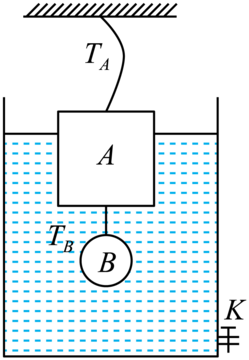

# Physics - 题目 1818

**ID**: 27df93e29dcc4121b1f0dc4c96c1670e
**年级**: Grade 9
**难度**: Hard
**题型**: Calculation

## 题目
如图所示，水平地面上放置一个底面积为0.03m^{2}薄壁圆柱形容器，容器侧面靠近底部有一控制出水的阀门K。​​​​​​​‌边长为0.1m的正方体木块A体积的 $\frac {9}{10}$ 浸入水中，下方用细线T_{B}系有重为3N的合金球B，B的体积是A体积的0.1倍。木块A上方的悬线T_{A}能承受的最大拉力为5N，此时悬线T_{A}处于松弛状态。（容器内的水足够深，不计细线的体积和质量，ρ_{水}=1.0×10^{3}kg/m^{3}，g取10N/kg）求：（1）木块A受到的浮力大小；（2）细线T_{B}对合金球B的拉力大小；（3）打开阀门K使水缓慢流出，当悬线T_{A}断裂的一瞬间关闭阀门K，此时木块A排开水的体积为多少？（4）若在悬线T_{A}断裂的一瞬间关闭阀门K同时剪断细线T_{B}，待木块A再次静止漂浮时，与悬线T_{A}断裂的瞬间相比，容器底受到水的压强改变了多少？

## 解答

1. 解：（1）由题意知A物体的体积为
2. $V{{}_{{\rm{A}}}}=(0.1{\rm{m}}){^{3}}=10{^{-3}}{\rm{m}}{^{3}}$
3. 此时A物体浸没在水中的体积为
4. $V{{}_{排{\rm{A}}}}=\frac {9}{10}(0.1{\rm{m}}){^{3}}=0.9\times 10{^{-3}}{\rm{m}}{^{3}}$
5. 根据阿基米德原理可知此时物体A受到浮力为
6. $F{{}_{浮{\rm{A}}}}{\rm{=}}ρ{{}_{水}}gV{{}_{排{\rm{A}}}}{\rm{=}}9{\rm{N}}$
7. （2）物体B的重力为 $G{{}_{{\rm{B}}}}=3{\rm{N}}$ ，B物体的体积为A物体体积的0.1倍
8. $V{{}_{{\rm{B}}}}=0.1\times V{{}_{{\rm{A}}}}=0.1\times (0.1{\rm{m}}){^{3}}=10{^{-4}}{\rm{m}}{^{3}}$
9. 由于物体B完全浸没在水中故
10. $V{{}_{排{\rm{B}}}}=V{{}_{{\rm{B}}}}=0.1\times V{{}_{{\rm{A}}}}=0.1\times (0.1{\rm{m}}){^{3}}=10{^{-4}}{\rm{m}}{^{3}}$
11. 根据阿基米德原理可得B物体在水中受到的浮力为
12. $F{{}_{浮{\rm{B}}}}{\rm{=}}ρ{{}_{水}}gV{{}_{排{\rm{B}}}}{\rm{=}}1{\rm{N}}$
13. 对物体B进行受力分析，受到一个向上T_{B}对合金球B的拉力，一个自身的重力3N，还有一个向上的浮力1N，在这3个力的作用下物体B处于平衡，故有以下关系
14. $T{{}_{{\rm{B}}}}+F{{}_{浮{\rm{B}}}}=T{{}_{{\rm{B}}}}+1{\rm{N}}=G{{}_{{\rm{B}}}}=3{\rm{N}}$
15. 所以
16. $T{{}_{{\rm{B}}}}=2{\rm{N}}$
17. （3）由于B受到一个向上T_{B}的拉力，所以B对A也有一个向下大小为T_{B}的拉力2N。对A进行分析，A受到一个向上大小为9N的浮力，受到一个自身的重力G_{A}，还受到一个向下的大小为2N的拉力，此时A处于平衡状态，故有关系式
18. $G{{}_{{\rm{A}}}}+T{{}_{{\rm{B}}}}=G{{}_{{\rm{A}}}}+2{\rm{N}}{\rm{=}}F{{}_{浮{\rm{A}}}}{\rm{=}}9{\rm{N}}$
19. 所以 $G{{}_{{\rm{A}}}}{\rm{=}}{\rm{7}}{\rm{N}}$ ，当悬线T_{A}断裂的一瞬间时，对A进行分析，此时A受到自身重力7N，受到B对A的拉力2N，受到向上的拉力T_{A}（由题意知绳子断掉时，T_{A}为5N），受到向上浮力 $F^{′}{{}_{浮A}}$ ，故有如下关系式
20. $G{{}_{{\rm{A}}}}+T{{}_{{\rm{B}}}}=F^{′}{{}_{浮{\rm{A}}}}+T{{}_{{\rm{A}}}}=7{\rm{N}}+2{\rm{N}}{\rm{=}}F^{′}{{}_{浮{\rm{A}}}}+5{\rm{N}}$
21. 故此时
22. $F^{′}{{}_{浮A}}=4{\rm{N}}$
23. 根据阿基米德原理
24. $F^{′}{{}_{浮A}}=4{\rm{N}}{\rm{=}}ρ{{}_{水}}gV^{′}{{}_{排{\rm{A}}}}$
25. 故
26. $V^{′}{{}_{排{\rm{A}}}}=4\times 10{^{-4}}{\rm{m}}{^{3}}$
27. （4）若悬线T_{A}断裂的一瞬间关闭阀门K同时剪断细线T_{B}，对A进行分析，此时A受到竖直向下重力7N，竖直向上浮力7N，故根据阿基米德原理有下式
28. $F^{′′}{{}_{浮{\rm{A}}}}=G{{}_{{\rm{A}}}}=7{\rm{N}}{\rm{=}}ρ{{}_{水}}gV^{′′}{{}_{排{\rm{A}}}}$
29. 则
30. $V^{′′}{{}_{排{\rm{A}}}}{\rm{=}}7\times 10{^{-4}}{\rm{m}}{^{3}}$
31. 由于容器底面积 $S=0.03{\rm{m}}{^{2}}$ ，根据液面高度变化量
32. $\Delta h\times S=\Delta h\times 0.03{\rm{m}}{^{2}}=V^{′′}{{}_{排{\rm{A}}}}-V^{′}{{}_{排{\rm{A}}}}=3\times 10{^{-4}}{\rm{m}}{^{3}}$
33. 故
34. $\Delta h{\rm{=}}10{^{-2}}{\rm{m}}$
35. 所以压强的变化量为
36. $\Delta p{\rm{=}}ρ{{}_{水}}g\Delta h{\rm{=}}{\rm{1}}{\rm{0}}{^{{\rm{3}}}}{\rm{k}}{\rm{g}}{\rm{/}}{\rm{m}}{^{{\rm{3}}}}\times {\rm{1}}{\rm{0}}{\rm{N}}{\rm{/}}{\rm{k}}{\rm{g}}\times {\rm{1}}{\rm{0}}{^{-2}}{\rm{m}}{\rm{=}}{\rm{1}}{\rm{0}}{\rm{0}}{\rm{P}}{\rm{a}}$
37. 答：（1）木块A受到的浮力大小为9N；
38. （2）细线T_{B}对合金球B的拉力大小为 $2{\rm{N}}$ ；
39. （3）打开阀门K使水缓慢流出，当悬线T_{A}断裂的一瞬间关闭阀门K，此时木块A排开水的体积为 $4\times 10{^{-4}}{\rm{m}}{^{3}}$ ；
40. （4）容器底受到水的压强改变了 ${\rm{1}}{\rm{0}}{\rm{0}}{\rm{P}}{\rm{a}}$ 。

## 知识点

**中文**:
  - 二力及多力平衡的判断和应用
  - 液体压强计算公式的应用
  - 阿基米德原理的应用

**English**:
  - Judgment and Application of Equilibrium of Forces
  - Application of Liquid Pressure Formula
  - Applications of Archimedes' Principle

---
