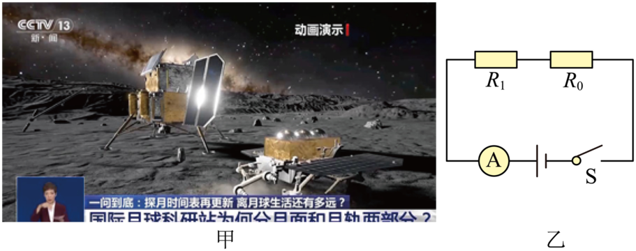

# Physics - 题目 1695

**ID**: 4e057cdfbc2f42438ed49bf13f8f959b
**年级**: Grade 9
**难度**: Hard
**题型**: Calculation

## 题目
为了更好地测月、巡天、观地，在2035年前后，中国将在月球建设国际科研站，如图甲所示。​​​​​​​‌小明同学了解到电流通过电阻后会发热，为了让月球科研站的宇航员生活更舒适，他设计了一个加热坐垫。加热坐垫电路如图乙所示，电流表量程为 $0\sim 3{\rm{A}}$ ，电阻 $R{{}_{1}}$ 的阻值为 $10Ω$ ，电流表示数为 $1{\rm{A}}$ ，电源电压为 $15{\rm{V}}$ 。求：（1）此时电阻 $R{{}_{1}}$ 两端的电压；（2）此时 $R{{}_{0}}$ 的电功率；（3）该电路总功率不变，使用受限，于是小田和小斌各自设计了可以调节总功率的改进电路，他们都把原电路中 $R{{}_{0}}$ 换为滑动变阻器，开关仍控制整个电路。小田把标有“？Ω　 $0.6{\rm{A}}$ ”的滑动变阻器 $R{{}_{2}}$ 以某种方式接入原电路中，发现电路中最小电功率为 $27{\rm{W}}$ 。小斌把标有“？Ω　 $1{\rm{A}}$ ”的滑动变阻器 $R{{}_{3}}$ 以某种方式接入原电路中，发现电路中最小电功率为 $7.5{\rm{W}}$ 。则 $R{{}_{2}}$ 、 $R{{}_{3}}$ 的最大阻值之比为多少。

## 解答

1. （1）由图乙可知，两电阻串联，电流表测电路中电流。由 $U=IR$ 可知电阻 $R{{}_{1}}$ 两端的电压 $U{{}_{1}}=IR{{}_{1}}=1{\rm{A}}\times 10\Omega =10{\rm{V}}$ 。
2. （2）由串联电路电压特点可知，R_{0}两端电压 $U{{}_{0}}=U-U{{}_{1}}=15{\rm{V}}-10{\rm{V}}=5{\rm{V}}$ ，则 $R{{}_{0}}=\frac {U{{}_{0}}}{I}=\frac {5{\rm{V}}}{1{\rm{A}}}=5Ω$ ，此时 $R{{}_{0}}$ 的电功率 $P=\frac {U{{}_{0}}{^{2}}}{R{{}_{0}}}=\frac {{\left({5{\rm{V}}}\right)^{2}}}{5Ω}=5{\rm{W}}$ 。
3. （3）若R_{1}单独接入电路，则R_{1}的功率 $P{{}_{1}}=\frac {U{^{2}}}{R{{}_{1}}}=\frac {{\left({15{\rm{V}}}\right)^{2}}}{10Ω}=22.5{\rm{W}}$ ，把原电路中 $R{{}_{0}}$ 换为滑动变阻器时，由 $P=\frac {U{^{2}}}{R}$ 可知，若电路中总电阻变大，则电路中电功率将减小，若电路中总电阻减小，则电功率将变大，由题意可知，滑动变阻器 $R{{}_{2}}$ 以某种方式接入原电路中，发现电路中最小电功率为 $27{\rm{W}}$ ，即电功率增大了，因此R_{2}是并联接入电路的，滑动变阻器 $R{{}_{3}}$ 以某种方式接入原电路中，发现电路中最小电功率为 $7.5{\rm{W}}$ ，电功率减小了，则R_{3}是串联接入电路的。当R_{2}并联接入电路时，有 $P{{}_{总}}=P{{}_{1}}+P{{}_{2}}=22.5{\rm{W}}+\frac {{\left({15{\rm{V}}}\right)^{2}}}{R{{}_{2}}}=27{\rm{W}}$ ，解得 $R{{}_{2}}=50Ω$ ，当R_{3}串联接入电路时，有 $P{{}_{总}}{^{\prime }}=\frac {U{^{2}}}{R{{}_{1}}+R{{}_{3}}}=\frac {{\left({15{\rm{V}}}\right)^{2}}}{10Ω+R{{}_{3}}}=7.5{\rm{W}}$ ，解得 $R{{}_{3}}=20Ω$ 。则 $R{{}_{2}}$ 、 $R{{}_{3}}$ 的最大阻值之比为 $\frac {R{{}_{2}}}{R{{}_{3}}}=\frac {50Ω}{20Ω}=\frac {5}{2}$ 。

## 知识点

**中文**:
  - 与欧姆定律有关的动态电路计算
  - 电功率的计算及应用

**English**:
  - Calculations in Dynamic Circuits using Ohm's Law
  - Calculation and Application of Electric Power

---
