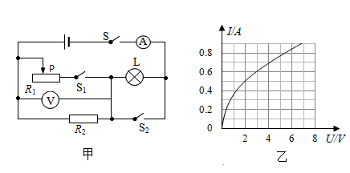

# Physics - 题目 954

**ID**: 51fba4c3681848e18e924e7c37478171
**年级**: Grade 9
**难度**: Hard
**题型**: Calculation

## 题目
如图甲，电源电压可以调节，滑动变阻器R_{1}的最大电阻为30Ω，定值电阻R_{2}上标有“6Ω6W”字样，电压表的量程为0~3V，电流表的量程为0~0.​​​​​​​‌6A；小灯泡L的电流随电压变化的图像如图乙所示：(1)电阻R_{2}正常工作时电流是多少？(2)将电源电压调节为2.4V恒定不变，当开关S、S_{1}、S_{2}均闭合时，变阻器R_{1}消耗的最大电功率与最小电功率之比是多少？(3)只闭合开关S，调节电源电压，在保证各电路元件都安全的情况下，整个电路在1min消耗的最大电能是多少？

## 解答

1. (1)由 $P=\frac {U{^{2}}}{R}$ 得，电阻R_{2}正常工作时电压是
2. $U{{}_{2}}=\sqrt {P{{}_{2}}R{{}_{2}}}=\sqrt {6{\rm{W}}\times 6{\rm{Ω}}}=6{\rm{V}}$
3. 由欧姆定律得，电阻R_{2}正常工作时电流是
4. $I{{}_{2}}=\frac {U{{}_{2}}}{R{{}_{2}}}=\frac {{\rm{6}}{\rm{V}}}{{\rm{6}}{\rm{Ω}}}={\rm{1}}{\rm{A}}$
5. (2)当开关S、S_{1}、S_{2}均闭合时，滑动变阻器R_{1}与R_{2}并联，电压表测量电源电压，电流表测量干路电流，由欧姆定律得，此时流过R_{2}的电流是
6. $I{{}_{2}}{^{^{′}}}=\frac {U{{}_{2}}{^{^{′}}}}{R{{}_{2}}{^{^{′}}}}=\frac {{\rm{2}}{\rm{.}}{\rm{4}}{\rm{V}}}{{\rm{6}}{\rm{Ω}}}=0.4{\rm{A}}$
7. 由于电流表的量程是0~0.6A，所以流过变阻器R_{1}的最大电流是
8. $I{{}_{1最大}}=I-I{{}_{2}}{^{^{′}}}=0.6{\rm{A}}-0.4{\rm{A}}=0.2{\rm{A}}$
9. 流过变阻器R_{1}的电流最大时，变阻器接入电流的电阻最小为
10. $R{{}_{1最小}}=\frac {U{{}_{1}}}{I{{}_{1最大}}}=\frac {{\rm{2}}{\rm{.}}{\rm{4}}{\rm{V}}}{{\rm{0}}{\rm{.}}{\rm{2}}{\rm{A}}}=12{\rm{Ω}}$
11. 此时变阻器R_{1}消耗的功率最大为
12. $P{{}_{1最大}}=\frac {U{{}_{1}}{^{2}}}{R{{}_{1最小}}}=\frac {{\left({{\rm{2}}{\rm{.}}{\rm{4}}{\rm{V}}{\rm{\;}}}\right)^{2}}}{12{\rm{Ω}}}=0.48{\rm{W}}$
13. 滑动变阻器R_{1}接入电流的电阻是30Ω时，消耗的功率最小为
14. $P{{}_{1最小}}=\frac {U{{}_{1}}{^{2}}}{R{{}_{1最大}}}=\frac {{\left({{\rm{2}}{\rm{.}}{\rm{4}}{\rm{V}}{\rm{\;}}}\right)^{2}}}{{\rm{3}}{\rm{0}}{\rm{Ω}}}=0.192{\rm{W}}$
15. 变阻器R_{1}消耗的最大电功率与最小电功率之比是
16. $\frac {P{{}_{1最大}}}{P{{}_{1最小}}}=\frac {0.48{\rm{W}}}{0.192{\rm{W}}}=\frac {5}{2}$
17. (3)只闭合开关S时，灯泡L与R_{2}串联，电压表测量R_{2}两端的电压，由于电压表的量程为0~3V，所以当R_{2}两端的电压最大为3V时，由欧姆定律得，此时电路中的最大电流是
18. $I{{}_{最大}}=I{{}_{2}}{^{^{′′}}}=\frac {U{{}_{2}}{^{^{′}}}{^{^{′}}}}{R{{}_{2}}}=\frac {{\rm{3}}{\rm{V}}}{{\rm{6}}{\rm{Ω}}}=0.5{\rm{A}}$
19. 当流过灯泡L的电流是0.5A时，由图乙可知，此时灯泡L两端的电压是2V，则电源电压最大为
20. $U=3{\rm{V}}+2{\rm{V}}=5{\rm{V}}$
21. 此时电路的最大功率是
22. $P{{}_{最大}}=UI{{}_{最大}}=5{\rm{V}}\times 0.5{\rm{A}}=2.5{\rm{W}}$
23. 由 $P=\frac {W}{t}$ ，在1min消耗的最大电能是
24. $W=Pt=2.5{\rm{W}}\times 60{\rm{s}}=150{\rm{J}}$
25. 答：(1)电阻R_{2}正常工作时电流是1A；
26. (2)当开关S、S_{1}、S_{2}均闭合时，变阻器R_{1}消耗的最大电功率与最小电功率之比是5:2；
27. (3)在保证各电路元件都安全的情况下，整个电路在1min消耗的最大电能是 $150{\rm{J}}$ 。

## 知识点

**中文**:
  - 与欧姆定律有关的动态电路计算
  - 电阻的伏安特性曲线
  - 电功率的计算及应用

**English**:
  - Calculations in Dynamic Circuits using Ohm's Law
  - I-V Characteristic Curve of Resistance
  - Calculation and Application of Electric Power

---
