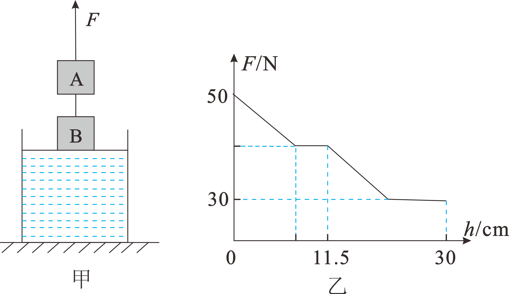

# Physics - 题目 418

**ID**: 5ca43bd1ec4f4a09a11fe9b5ae869323
**年级**: Grade 9
**难度**: Hard
**题型**: Calculation

## 题目
如图甲所示，A、B为不同材料制成的体积相同的实心正方体，物体A的质量为0.8 kg，圆柱形容器的底面积是A或B下表面积的4倍。​​​​​​​‌B的下表面刚好在水面上，现沿竖直方向将A、B缓慢放入水中，直到B接触容器底部。上端绳子的拉力是F，F随B下降的距离h变化的图像如图乙所示。绳的质量和体积忽略不计。求：（1）物体B的重力；（2）物体B的密度；（3）当B接触容器底部时，水对A下表面的压强。

## 解答

1. 解：（1）物体A的重力
2. $G{{}_{{\rm{A}}}}=m{{}_{{\rm{A}}}}g=0.8{\rm{k}}{\rm{g}}\times 10{\rm{N}}{\rm{/}}{\rm{k}}{\rm{g}}=8{\rm{N}}$
3. 当h=0时，绳子的拉力大小等于物体A、B的重力之和，由图可知，当h=0时，拉力大小F_{0}=50N，则物体B的重力为
4. $G{{}_{{\rm{B}}}}=F{{}_{0}}-G{{}_{{\rm{A}}}}=50{\rm{N}}-8{\rm{N}}=42{\rm{N}}$
5. （2）由图可知，绳子的拉力最后变为30N不变，此时物体A、B完全浸没在水中，浮力不变，此时物体A、B所受浮力之和为
6. $F{{}_{浮}}=G{{}_{总}}-F{{}_{1}}=\left ({G{{}_{{\rm{A}}}}+G{{}_{{\rm{B}}}}}\right )-F{{}_{1}}=\left ({8{\rm{N}}+42{\rm{N}}}\right )-30{\rm{N}}=20{\rm{N}}$
7. 物体A、B排开水的体积为
8. $V{{}_{排}}=\frac {F{{}_{浮}}}{ρ{{}_{水}}g}=\frac {20{\rm{N}}}{1\times 10{^{3}}{\rm{k}}{\rm{g}}{\rm{/}}{\rm{m}}{^{{\rm{3}}}}\times 10{\rm{N}}{\rm{/}}{\rm{k}}{\rm{g}}}=2\times 10{^{-3}}{\rm{m}}{^{3}}$
9. 物体A、B的体积相同，所以物体B的体积为
10. $V{{}_{{\rm{B}}}}=V{{}_{{\rm{A}}}}=\frac {V{{}_{排}}}{2}=\frac {2\times 10{^{-3}}{\rm{m}}{^{3}}}{2}=1\times 10{^{-3}}{\rm{m}}{^{3}}$
11. 物体B的质量
12. $m{{}_{{\rm{B}}}}=\frac {G{{}_{{\rm{B}}}}}{g}=\frac {42{\rm{N}}}{10{\rm{N}}{\rm{/}}{\rm{k}}{\rm{g}}}=4.2{\rm{k}}{\rm{g}}$
13. 物体B的密度为
14. $ρ{{}_{{\rm{B}}}}=\frac {m{{}_{{\rm{B}}}}}{V{{}_{{\rm{B}}}}}=\frac {4.2{\rm{k}}{\rm{g}}}{1\times 10{^{-3}}{\rm{m}}{^{3}}}=4.2\times 10{^{3}}{\rm{k}}{\rm{g}}{\rm{/}}{\rm{m}}{^{{\rm{3}}}}$
15. （3）物体A、B的边长为
16. $l=\sqrt[3]{V{{}_{{\rm{B}}}}}=\sqrt[3]{1\times 10{^{-3}}{\rm{m}}{^{3}}}=0.1{\rm{m}}$
17. 由图可知，当h=30cm时，B接触容器底部，所以原来烧杯中水的深度为30cm，A、B的底面积为
18. $S=l{^{2}}={\left({0.1{\rm{m}}}\right)^{2}}=0.01{\rm{m}}{^{2}}$
19. 烧杯的底面积
20. $S＇=4S=4\times 0.01{\rm{m}}{^{2}}=0.04{\rm{m}}{^{2}}$
21. 当A、B完全浸没以后，液面上升的高度为
22. $h＇=\frac {V{{}_{排}}}{S＇}=\frac {2\times 10{^{-3}}{\rm{m}}{^{3}}}{0.04{\rm{m}}{^{2}}}=0.05{\rm{m}}=5{\rm{c}}{\rm{m}}$
23. 当A、B完全浸没以后，烧杯中水的深度为
24. $h＂=h+h＇=30{\rm{c}}{\rm{m}}+5{\rm{c}}{\rm{m}}=35{\rm{c}}{\rm{m}}$
25. 由图可知，当h=11.5cm时，绳子的拉力第二次减小，说明此时物体A开始进入水中，此时只有B浸没在水中，液面上升的高度是物体A、B完全浸没液面上升高度的一半，即此时液面上升高度为
26. $Δh=\frac {h＇}{2}=\frac {5{\rm{c}}{\rm{m}}}{2}=2.5{\rm{c}}{\rm{m}}$
27. 由题意可知，A、B之间绳子的长度为
28. $l＇=h{{}_{1}}+Δh-l=11.5{\rm{c}}{\rm{m}}+2.5{\rm{c}}{\rm{m}}-10{\rm{c}}{\rm{m}}=4{\rm{c}}{\rm{m}}$
29. 当B接触容器底部，A下表面到容器底部的距离为
30. $h{{}_{2}}=l+l＇=10{\rm{c}}{\rm{m}}+4{\rm{c}}{\rm{m}}=14{\rm{c}}{\rm{m}}$
31. A下表面到液面的距离为
32. $h{{}_{3}}=h＂-h{{}_{2}}=35{\rm{c}}{\rm{m}}-14{\rm{c}}{\rm{m}}=21{\rm{c}}{\rm{m}}=0.21{\rm{m}}$
33. 则当B接触容器底部时，水对A下表面的压强
34. $p=ρ{{}_{水}}gh{{}_{3}}=1\times 10{^{3}}{\rm{k}}{\rm{g}}{\rm{/}}{\rm{m}}{^{3}}\times 10{\rm{N}}{\rm{/}}{\rm{k}}{\rm{g}}\times 0.21{\rm{m}}=2.1\times 10{^{3}}{\rm{P}}{\rm{a}}$
35. 答：（1）物体B的重力为 $42{\rm{N}}$ ；
36. （2）物体B的密度为 $4.2\times 10{^{3}}{\rm{k}}{\rm{g}}{\rm{/}}{\rm{m}}{^{{\rm{3}}}}$ ；
37. （3）当B接触容器底部时，水对A下表面的压强为 $2.1\times 10{^{3}}{\rm{P}}{\rm{a}}$ 。

## 知识点

**中文**:
  - 密度、压强和浮力的综合

**English**:
  - Integrated Density, Pressure, and Buoyancy

---
