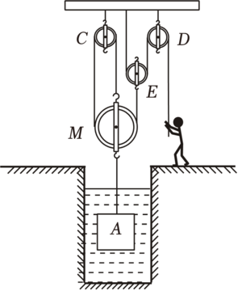

# Physics - 题目 1563

**ID**: 6486748f03504dde9405d371cf0c633e
**年级**: Grade 9
**难度**: Hard
**题型**: Calculation

## 题目
工作人员用如图所示装置打捞水中的物体。​​​​​​​‌第一次提体积V_{A}=6×10^{﹣}^{3}m^{3}的物体A在水中匀速上升的过程中（A未露出水面），人对绳子竖直向下的拉力为F_{1}，人拉力的功率为P_{1}，绳端的速度为v_{1}，机械效率为η_{1}；第二次提重为G_{B}=150N的物体B在水中匀速上升的过程中（B未露出水面），人对绳子竖直向下的拉力为F_{2}，人拉力的功率为P_{2}，绳端的速度为v_{2}，机械效率为η_{2.}。已知：功率P_{1}：P_{2}=2：1，η_{1}：η_{2}=3：2，物体A、B的体积V_{A}：V_{B}=1：2，重力G_{A}：G_{B}=4：5，四个滑轮质量相等，忽略绳重、绳与滑轮间摩擦及液体对物体的阻力（g取10N/kg）（1）物体B所受的浮力F_{浮}；（2）动滑轮的重G_{动}；（3）速度v_{1}、v_{2}的比值。

## 解答

1. 解：（1）已知：V_{A}=6×10^{﹣}^{3}m^{3}，V_{A}：V_{B}=1：2，则V_{B}=2×6×10^{﹣}^{3}m^{3}=0.012m^{3}
2. 根据阿基米德原理可知物体B在水中所受的浮力F_{浮}_{B}=ρ_{水}_{，}V_{B}=1×10^{3}kg/m^{3}×10N/kg×0.012m^{3}=120N。
3. （2）已知：G_{B}=150N，G_{A}：G_{B}=4：5，则物体A的重力为 $G{{}_{{\rm{A}}}}=\frac {4}{5}G{{}_{{\rm{B}}}}=\frac {4}{5}\times 1{\rm{5}}{\rm{0}}{\rm{N}}{\rm{=}}{\rm{1}}{\rm{2}}{\rm{0}}{\rm{N}}$
4. 物体A在水中所受的浮力F_{浮}_{A}=ρ_{水}gV_{A}=1×10^{3}kg/m^{3}×10N/kg×6×10^{﹣}^{3}m^{3}=60N，因动滑轮M是3股绳子承担，所以动滑轮M和提升物体升高h时，忽略绳重、绳与滑轮间摩擦及液体对物体的阻力时，滑轮组的额外功就是因提升动滑轮M和E而产生的，即额外功
5. W_{额}=G_{动}h+G_{动}3h=4G_{动}h，根据 $η=\frac {W{{}_{有}}}{W{{}_{总}}}=\frac {W{{}_{有}}}{W{{}_{有}}+W{{}_{额}}}=\frac {\left ({G-F{{}_{浮}}}\right )h}{\left ({G-F{{}_{浮}}}\right )h+4G{{}_{动}}h}=\frac {G-F{{}_{浮}}}{G-F{{}_{浮}}+4G{{}_{动}}}$ 得
6. $η{{}_{1}}=\frac {G{{}_{{\rm{A}}}}-F{{}_{浮A}}}{G{{}_{A}}-F{{}_{浮A}}+4G{{}_{动}}}$ ， $η{{}_{2}}=\frac {G{{}_{{\rm{B}}}}-F{{}_{浮B}}}{G{{}_{B}}-F{{}_{浮B}}+4G{{}_{动}}}$ ，因为η_{1}：η_{2}=3：2，所以， $\frac {G{{}_{{\rm{A}}}}-F{{}_{浮A}}}{G{{}_{A}}-F{{}_{浮A}}+4G{{}_{动}}}：\frac {G{{}_{{\rm{B}}}}-F{{}_{浮B}}}{G{{}_{B}}-F{{}_{浮B}}+4G{{}_{动}}}=3:2$ ，即 $\frac {{\rm{1}}{\rm{2}}{\rm{0}}{\rm{N}}{\rm{-}}{\rm{6}}{\rm{0}}{\rm{N}}}{{\rm{1}}{\rm{2}}{\rm{0}}{\rm{N}}{\rm{-}}{\rm{6}}{\rm{0}}{\rm{N}}{\rm{+}}{\rm{4}}{\rm{G}}{{}_{动}}}：\frac {{\rm{1}}{\rm{5}}{\rm{0}}{\rm{N}}{\rm{-}}{\rm{1}}{\rm{2}}{\rm{0}}{\rm{N}}}{{\rm{1}}{\rm{5}}{\rm{0}}{\rm{N}}{\rm{-}}{\rm{1}}{\rm{2}}{\rm{0}}{\rm{N}}{\rm{+}}{\rm{4}}{\rm{G}}{{}_{动}}}=3:2$
7. 解得G_{动}=15N。
8. （3）提升物体时，动滑轮E受力分析：重力、滑轮组CM对动滑轮E的向下拉力 $F\prime =\frac {1}{3}\left ({G-F{{}_{浮}}+G{{}_{动}}}\right )$ 和向上的两股绳子的拉力F，根据动滑轮E受力平衡得
9. 2F=G_{动}+F′，所以有 $F=\frac {1}{2}\left ({G{{}_{动}}+F^{′}}\right )=\frac {1}{2}\left [G{{}_{动}}+\frac {1}{3}\left ({G-F{{}_{浮}}+G{{}_{动}}}\right )\right ]=\frac {1}{6}\left ({G-F{{}_{浮}}+4G{{}_{动}}}\right )$
10. 则据此可知 $F{{}_{1}}=\frac {1}{6}\left ({G{{}_{{\rm{A}}}}-F{{}_{浮A}}+4G{{}_{动}}}\right )=\frac {1}{6}\times \left ({120{\rm{N}}-{\rm{6}}{\rm{0}}{\rm{N}}{\rm{+}}{\rm{4}}{\rm{×}}{\rm{1}}{\rm{5}}{\rm{N}}}\right )=2{\rm{0}}{\rm{N}}$ ， $F{{}_{2}}=\frac {1}{6}\left ({G{{}_{{\rm{B}}}}-F{{}_{浮B}}+4G{{}_{动}}}\right )=\frac {1}{6}\times \left ({150{\rm{N}}-{\rm{1}}{\rm{2}}{\rm{0}}{\rm{N}}{\rm{+}}{\rm{4}}{\rm{×}}{\rm{1}}{\rm{5}}{\rm{N}}}\right )=15{\rm{N}}$ ，因为P_{1}=F_{1}v_{1}，P_{2}=F_{2}v_{2}，P_{1}：P_{2}=2：1，所以有F_{1}v_{1}：F_{2}v_{2}=2：1，即 $2{\rm{0}}{\rm{N}}\times v{{}_{1}}：15{\rm{N}}\times v{{}_{2}}=2：1$ ，解得 $v{{}_{1}}：v{{}_{2}}=3：2$ 。
11. 答：（1）物体B所受的浮力F_{浮}为120N；
12. （2）动滑轮的重G_{动}为15N；
13. （3）速度v_{1}、v_{2}的比值为3：2。

## 知识点

**中文**:
  - 功率的计算和估算
  - 阿基米德原理的应用
  - 滑轮组及其工作特点
  - 有用功、额外功和总功的计算

**English**:
  - Calculation and Estimation of Power
  - Applications of Archimedes' Principle
  - Pulley Systems and Operating Characteristics
  - Calculation of Useful, Extra, and Total Work

---
