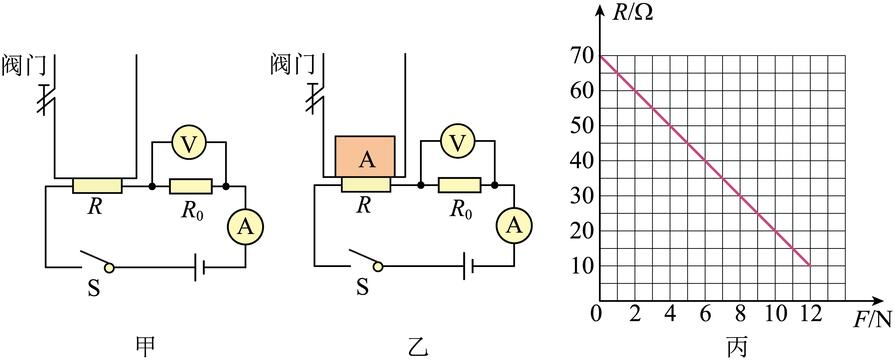

# Physics - 题目 676

**ID**: 8f98a33c95964c6b9d0d9e654bc199ea
**年级**: Grade 9
**难度**: Hard
**题型**: Calculation

## 题目
某科技小组为了测量物质的密度，设计了一套测量装置。​​​​​​​‌电源电压为18V且保持不变，R_{0}为定值电阻，出水口带有阀门的溢水杯装满水（如图甲所示）放置在压力传感器R上，闭合开关时电流表的示数为0.3A，电压表示数为3V；关闭阀门，把物块A放入水中沉底，如图乙所示，电流表的示数变化了0.15A；再打开阀门，当水停止流出时，电流表的示数又变化了0.05A，已知：压力传感器上表面的面积为20cm^{2}，其阻值R与其受到的压力F的关系如图丙所示。求：（1）R_{0}的阻值；（2）甲图中溢水杯对压力传感器的压强；（3）物块A的密度。

## 解答

1. 解：（1）图中两个电阻串联，电压表测量定值电阻的电源，根据欧姆定律计知，R_{0}的阻值 $R{{}_{0}}=\frac {U{{}_{0}}}{I{{}_{0}}}=\frac {{{3}}{\rm{V}}}{{{0}}{{.}}{{3}}{\rm{A}}}=10Ω$ 。
2. （2）压力传感器的电压为 $U^{′}=U﹣U{{}_{0}}=1{{8}}{\rm{V}}﹣{{3}}{\rm{V}}={{1}}{{5}}{\rm{V}}$ ，根据欧姆定律计知，则传感器的电阻 $R=\frac {U^{′}}{I}=\frac {{{1}}{{5}}{\rm{V}}}{{{0}}{{.}}{{3}}{\rm{A}}}=50Ω$ ，对照图像知，压力 $F=4{\rm{N}}$ ，压强 $p=\frac {F}{S}=\frac {{{4}}{\rm{N}}}{20\times 10{^{-4}}{\rm{m}}{^{2}}}=2000{\rm{P}}{\rm{a}}$ 。
3. （3）当A放入时，压力增大，压敏电阻减小，电路中的电流增大，电流为 $I^{′}=0.3{\rm{A}}+0.15{\rm{A}}{\rm{=}}0.45{\rm{A}}$ ，总电阻大小 $R{{}_{总}}=\frac {U}{I^{′}}=\frac {{{1}}{{8}}{\rm{V}}}{{{0}}{{.}}{{4}}{{5}}{\rm{A}}}=40Ω$ ，传感器的电阻 $R^{′}=R{{}_{总}}﹣R{{}_{0}}=40Ω﹣10Ω=30Ω$ ，此时的拉力为 $F^{′′}=8{\rm{N}}$ ，则物体的重力 $G=8{\rm{N}}﹣{{4}}{\rm{N}}={{4}}{\rm{N}}$ ，当打开阀门，当水停止流出时，电阻变大，电流表的示数又变化了0.05A，此时电流为 $I^{′′}=0.45{\rm{A}}{{-}}{{0}}{{.}}{{0}}{{5}}{\rm{A}}{\rm{=}}0.4{\rm{A}}$ ，总电阻大小 $R{{}_{总}}{^{\prime }}=\frac {U}{I^{′′}}=\frac {{{1}}{{8}}{\rm{V}}}{{{0}}{{.}}{{4}}{\rm{A}}}=45Ω$ ，传感器的电阻 $R^{′′}=R^{′}{{{}_{总}}}﹣R{{}_{0}}=45Ω﹣10Ω=35Ω$ ，此时的拉力为 $F^{′}=4{\rm{N}}$ ，则排开水的重力 $G=8{\rm{N}}﹣{{7}}{\rm{N}}={{7}}{\rm{N}}$ ，根据 $G=mg=ρVg=4{\rm{N}}$ ……①， $G{{}_{排}}=m{{}_{排}}g=ρ{{}_{水}}Vg=1{\rm{N}}$ ……②，联立①②得 $ρ=4ρ{{}_{水}}={{4}}\times 10{^{3}}{\rm{k}}{\rm{g}}{\rm{/}}{\rm{m}}{^{3}}$ 。
4. （1）R_{0}的阻值为10Ω；
5. （2）甲图中溢水杯对压力传感器的压强2000Pa；
6. （3）物块A的密度是4×10^{4}kg/m^{3}。

## 知识点

**中文**:
  - 压强的计算
  - 阿基米德原理的应用
  - 欧姆定律的应用
  - 电路的动态分析

**English**:
  - Calculation of Pressure
  - Applications of Archimedes' Principle
  - Applications of Ohm's Law
  - Dynamic Circuit Analysis

---
