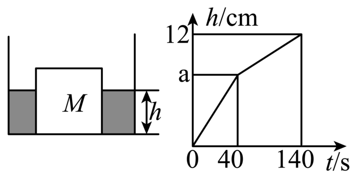

# Physics - 题目 1913

**ID**: 9dfbb500799844888afc243c274dacf3
**年级**: Grade 9
**难度**: Hard
**题型**: Calculation

## 题目
如图甲所示，水平放置的方形容器里有一个重为8N，棱长为10cm的立方体物块M，M与容器底部不密合，容器中水的深度h随时间t的变化关系如图乙所示。​​​​​​​‌(1)当t=140s时，容器底部受到水的压强为多少？(2)在0~140s的过程中，浮力对物体M做功多少？(3)在140s时，在物体M上放置一个体积为25cm^{3}的物体A后，物体M下表面所受的液体压强为1000Pa。请求出物体A的密度大小。

## 解答

1. 解：(1)由图像可知，当t=140s时，水的深度为
2. $h=12{\rm{c}}{\rm{m}}=0.12{\rm{m}}$
3. 容器底部受到水的压强
4. $p=ρgh=1.0\times 10{^{3}}{\rm{k}}{\rm{g}}{\rm{/}}{\rm{m}}{^{3}}\times 10{\rm{N}}{\rm{/}}{\rm{k}}{\rm{g}}\times 0.12{\rm{m}}=1200{\rm{P}}{\rm{a}}$
5. (2)当t=40s时，正好是物块M处于刚刚开始漂浮的状态，则
6. $F{{}_{浮}}=G{{}_{{\rm{M}}}}=8N$
7. 由阿基米德原理可知，此时排开液体的体积
8. $V{{}_{排}}=\frac {F{{}_{浮}}}{ρ{{}_{水}}g}=\frac {8{\rm{N}}}{1.0\times 10{^{3}}{\rm{k}}{\rm{g}}{\rm{/}}{\rm{m}}{^{3}}\times 10{\rm{N}}{\rm{/}}{\rm{k}}{\rm{g}}}=8\times 10{^{-4}}{\rm{m}}{^{3}}=800{\rm{c}}{\rm{m}}{^{3}}$
9. 所以深度
10. $a=\frac {V{{}_{排}}}{S{{}_{{\rm{M}}}}}=\frac {800{\rm{c}}{\rm{m}}{^{3}}}{{\left({10{\rm{c}}{\rm{m}}}\right)^{2}}}=8{\rm{c}}{\rm{m}}$
11. 在0~40s阶段，由于物体M没有升高，则上升的高度为0，所以
12. $W=0{\rm{J}}$
13. 在40~140s阶段，物块M上升的高度
14. $h＇=12{\rm{c}}{\rm{m}}-8{\rm{c}}{\rm{m}}=4{\rm{c}}{\rm{m}}={\rm{0}}{\rm{.}}{\rm{0}}{\rm{4}}{\rm{m}}$
15. 则浮力对物体做的功
16. $W=F{{}_{浮}}h＇=8{\rm{N}}\times 0.04{\rm{m}}=0.32{\rm{J}}$
17. (3)物块M的体积为
18. $V={\left({0.1{\rm{m}}}\right)^{3}}=0.001{\rm{m}}{^{3}}$
19. 物块M的质量
20. $m=\frac {G}{g}=\frac {8{\rm{N}}}{10{\rm{N}}{\rm{/}}{\rm{k}}{\rm{g}}}=0.8{\rm{k}}{\rm{g}}$
21. 物块M的密度
22. $ρ{{}_{{\rm{M}}}}=\frac {m}{V}=\frac {0.8{\rm{k}}{\rm{g}}}{0.001{\rm{m}}{^{3}}}=0.8\times 10{^{3}}{\rm{k}}{\rm{g}}{\rm{/}}{\rm{m}}{^{3}}$
23. 物块的密度小于水的密度，根据浮沉条件可知，物块M在水中将漂浮；在物体M上放置一个体积为25cm^{3}的物体A后，物体M下表面所受的液体压强为1000Pa，则此时物体M浸入水中的深度
24. $h{{}_{1}}=\frac {p{{}_{1}}}{ρ{{}_{水}}g}=\frac {1000{\rm{P}}{\rm{a}}}{1.0\times 10{^{3}}{\rm{k}}{\rm{g}}{\rm{/}}{\rm{m}}{^{3}}\times 10{\rm{N}}{\rm{/}}{\rm{k}}{\rm{g}}}=0.1{\rm{m}}$
25. 由此可知，在物体M上放置一个体积为25cm^{3}的物体A后，物体M和物体A整体处于漂浮状态，此时
26. $F{{}_{浮}}＇=G{{}_{{\rm{M}}}}+G{{}_{{\rm{A}}}}$
27. 即
28. $ρ{{}_{水}}gV{{}_{排}}＇=8N+ρ{{}_{{\rm{A}}}}gV{{}_{{\rm{A}}}}$
29. 即
30. $ρ{{}_{水}}gSh{{}_{1}}=8N+ρ{{}_{{\rm{A}}}}gV{{}_{{\rm{A}}}}$
31. 即
32. $1.0\times 10{^{3}}{\rm{k}}{\rm{g}}{\rm{/}}{\rm{m}}{^{3}}\times 10{\rm{N}}{\rm{/}}{\rm{k}}{\rm{g}}\times {\left({0.1{\rm{m}}}\right)^{2}}\times 0.1{\rm{m}}=8N+ρ{{}_{{\rm{A}}}}g\times 25\times 10{^{-6}}{\rm{m}}{^{3}}$
33. 解得
34. $ρ{{}_{{\rm{A}}}}=8\times 10{^{3}}{\rm{k}}{\rm{g}}{\rm{/}}{\rm{m}}{^{3}}$
35. 答：(1)当t=140s时，容器底部受到水的压强为1200Pa；
36. (2)在0~140s的过程中，浮力对物体M做功为0.32J；
37. (3)物体A的密度为 $8\times 10{^{3}}{\rm{k}}{\rm{g}}{\rm{/}}{\rm{m}}{^{3}}$ 。

## 知识点

**中文**:
  - 功的计算和估算
  - 密度、压强和浮力的综合

**English**:
  - Calculation and Estimation of Work
  - Integrated Density, Pressure, and Buoyancy

---
