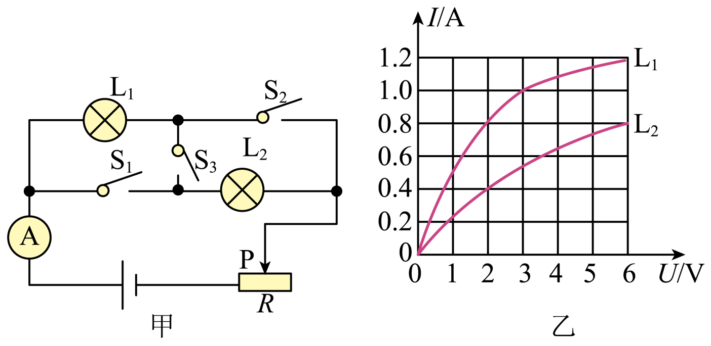

# Physics - 题目 836

**ID**: af1bbff5555b4894bd484ed49ff3201d
**年级**: Grade 9
**难度**: Hard
**题型**: Calculation

## 题目
如图甲所示电路，电源电压可调，R为标有“1A“字样的滑动变阻器，电流表量程为0～3A，L_{1}、L_{2}是额定电压均为6V的小灯泡，其电流与电压的关系如图乙所示。​​​​​​​‌求：（1）L_{2}正常发光时的电阻；（2）若只闭合开关S_{1}，电源电压调节为10V，滑片P滑至中点时小灯泡正常发光，滑动变阻器的最大阻值；（3）若不清楚电路中各开关闭合或断开的状态，滑动变阻器滑片P的移动范围为2Ω至最大阻值处，现移动滑片P同时调节电源电压，使电路中两个小灯泡均发光且有小灯泡正常发光，电路中各元件均安全工作，求对应电路总电功率的变化范围。

## 解答

1. 解：（1）L_{2}正常发光时通过的电流为0,8A，L_{2}的电阻 $R{{}_{2}}=\frac {U{{}_{2}}}{I{{}_{2}}}=\frac {6{\rm V}}{0.8{\rm A}}=7.5\Omega $
2. （2）若只闭合开关S_{1}，滑动变阻器和灯泡L_{2}串联，小灯泡正常发光时,电源电压调节为10V，滑片P滑至中点时滑动变阻器两端的电压为4V，此时滑动变阻器接入电路的阻值为 $\frac {R}{2}$  ，则 $\frac {R}{2}=\frac {U{{}_{R}}}{I{{}_{2}}}=\frac {4{\rm V}}{0.8{\rm A}}$
3. 解得滑动变阻器的最大值 $R=10Ω$
4. （3）若L_{1}、L_{2}并联，再与变阻器串联，则两灯泡均正常发光时，干路电流为 $I=I{{}_{1}}+I{{}_{2}}=1.2{\rm A}+0.8{\rm A}=2{\rm A}$
5. 不能保证变阻器安全；因此使电路中两个小灯泡均发光且有小灯泡正常发光，电路中各元件均安全工作，应该只闭合S_{3}，让两个灯泡及滑动变阻器串联，由图乙可知L_{1}的额定电流大于L_{2}的额定电流，因此只能让L_{2}正常发光，此时电路中的电流为0.8A，由图乙可知，此时L_{1}两端的电压为2V，当变阻器接入的电阻为 $2Ω$ 时，电源电压 $U=U{{}_{{\rm L}{{}_{2}}}}+U{{}_{R}}+U{{}_{{\rm L}{{}_{1}}}}=6{\rm V}+2\Omega \times 0.8{\rm A}+2{\rm V}=9.6{\rm V}$
6. 对应电路总电功率为 $P=UI=9.6{\rm V}\times 0.8{\rm A}=7.68{\rm W}$
7. 当变阻器接入的电阻为 $10Ω$ 时，电路中的电流为0.8A，由图乙可知，L_{1}两端的电压为2V，电源电压  $U^{′}=U^{′}{{{}_{{\rm L}{{}_{2}}}}}+U^{′}{{{}_{R}}}+U^{′}{{{}_{{\rm L}{{}_{1}}}}}=6{\rm V}+10\Omega \times 0.8{\rm A}+2{\rm V}=16{\rm V}$
8. 对应电路总电功率为 $P^{′}=U^{′}I=16{\rm V}\times 0.8{\rm A}=12.8{\rm W}$
9. 对应电路总电功率的变化范围为 $7.68{\rm W}\sim 12.8{\rm W}$ 。
10. 答：（1）L_{2}正常发光时的电阻为 $7.5Ω$ ；
11. （2）滑动变阻器的最大阻值为 $10Ω$ ；
12. （3）对应电路总电功率的变化范围为 $7.68{\rm W}\sim 12.8{\rm W}$ 。

## 知识点

**中文**:
  - 与欧姆定律有关的动态电路计算
  - 电阻的伏安特性曲线
  - 电功率的计算及应用

**English**:
  - Calculations in Dynamic Circuits using Ohm's Law
  - I-V Characteristic Curve of Resistance
  - Calculation and Application of Electric Power

---
