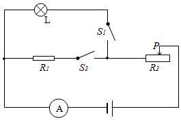

# Physics - 题目 641

**ID**: b1b09b2796074c87b594b7a4681103cd
**年级**: Grade 9
**难度**: Hard
**题型**: Calculation

## 题目
如图电路中，电源电压恒定，小灯泡L标有“6V 6W”，电阻R_{1}的阻值为10Ω，滑动变阻器R_{2}标有“20Ω 0.5A”。​​​​​​​‌当R_{2}的滑片P置于最左端时，只闭合S_{1}，灯泡正常发光。（1）求小灯泡正常发光时的电流和电阻；（2）滑片P置于最左端，闭合S_{1}、S_{2}，求10s内电路消耗的总电能；（3）滑片P置于最右端，只闭合S_{2}，移动滑片P，使R_{2}的电功率占电路总功率的比值最小，则R_{2}的电功率多大？

## 解答

1. 解：（1）根据P=UI得小灯泡正常发光的电流
2. $I{{}_{额}}=\frac {P{{}_{额}}}{U{{}_{额}}}=\frac {{\rm{6}}{\rm{W}}}{{\rm{6}}{\rm{V}}}=1{\rm{A}}$
3. 小灯泡正常发光的电阻
4. $R{{}_{{\rm{L}}}}=\frac {U{{}_{额}}}{I{{}_{额}}}=\frac {{\rm{6}}{\rm{V}}}{{\rm{1}}{\rm{A}}}=6{\rm{Ω}}$
5. （2）当R_{2}的滑片P置于最左端时，只闭合S_{1}，电路为只有灯泡L工作的电路，灯泡正常发光，说明灯泡两端的电压为电源电压，故
6. U=U_{额}=6V
7. 滑片P置于最左端，闭合S_{1}、S_{2}，电路为灯泡L和电阻R_{1}并联的电路，通过电阻R_{1}的电流为
8. $I{{}_{1}}=\frac {U}{R{{}_{1}}}=\frac {6{\rm V}}{10{\rm W}}=0.6{\rm{A}}$
9. 干路的电流为
10. I=I_{额}+I_{1}=1A+0.6A=1.6A
11. 10s内电路消耗的总电能
12. W=UIt=6V×1.6A×10s=96J
13. （3）滑片P置额于最右端，只闭合S_{2}，电路为电阻R_{1}的和R_{2}串联的电路，滑动变阻器R_{2}消耗的电功率为P_{2}=U_{2}I电路总功率P=UI的比值
14. $\frac {P{{}_{2}}}{P}=\frac {U{{}_{2}}I}{UI}=\frac {U{{}_{2}}}{U}=\frac {R{{}_{2}}}{R{{}_{2}}+R{{}_{1}}}$
15. R_{1}一定，要想使这个比值最小，则滑动变阻器R_{2}接入电路的电阻最小，同时电流不能超过0.5A，即
16. I_{max}=0.5A
17. 此时电路的总电阻为
18. $R{{}_{总}}=\frac {U}{I{{}_{{\rm \max }}}}=\frac {{\rm{6}}{\rm{V}}}{{\rm{0}}{\rm{.}}{\rm{5}}{\rm{A}}}=12{\rm{Ω}}$
19. R_{2}的最小电阻为
20. R_{2}_{小}=R_{总}-R_{1}=12Ω-10Ω=2Ω
21. 当R_{2}为2Ω时，R_{2}的电功率占电路总功率的比值最小，则R_{2}的电功率
22. P_{2}_{小}=I_{max}^{2}R_{2}_{小}=(0.5A)^{2}×2Ω=0.5W
23. 答：（1）小灯泡正常发光时的电流和电阻分别为1A和6Ω；
24. （2）滑片P置于最左端，闭合S_{1}、S_{2}，10s内电路消耗的总电能为96J；
25. （3）滑片P置于最右端，只闭合S_{2}，移动滑片P，使R_{2}的电功率占电路总功率的比值最小，则R_{2}的电功率为0.5W。

## 知识点

**中文**:
  - 欧姆定律的应用
  - 电路的动态分析
  - 电功与电能的计算
  - 电功率的计算及应用

**English**:
  - Applications of Ohm's Law
  - Dynamic Circuit Analysis
  - Calculation of Electric Work and Energy
  - Calculation and Application of Electric Power

---
