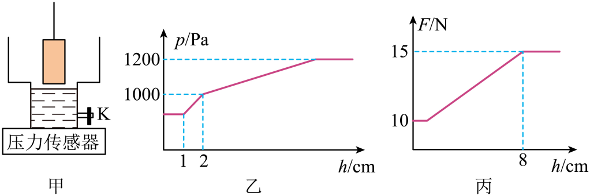

# Physics - 题目 229

**ID**: d1c415bcb3f64ab88914d60a618f5e8f
**年级**: Grade 9
**难度**: Hard
**题型**: Calculation

## 题目
一个上宽下小且上下均为圆柱形的足够高的容器，下底面积为 $100{\rm{c}}{\rm{m}}{^{2}}$ ，内装有 $9\,{\rm{c}}{\rm{m}}$ 深的水，将其置于压力传感器上，如图甲所示。​​​​​​​‌ ${\rm A}$ 是底面积为 $50\,{\rm{c}}{\rm{m}}{^{2}}$ 的不吸水的实心圆柱体，重力为 $15{\rm{N}}$ 。用足够长的轻质细硬杆连接 ${\rm A}$ 并使其缓慢浸入水中，直至 ${\rm A}$ 的下表面触碰容器底部，图乙是水对容器底部的压强随 ${\rm A}$ 下降高度 $h$ 变化的图像，图丙是压力传感器的示数随 ${\rm A}$ 下降高度 $h$ 变化的图像。 $\left ({ρ{{}_{水}}=1.0\times 10{^{3}}\,{\rm{k}}{\rm{g}}/{\rm{m}}{^{3}}，g取10\,{\rm{N}}/{\rm{k}}{\rm{g}}}\right )$ 求：（1）未放入圆柱体 ${\rm A}$ 时，容器底部受到的压力；（2）圆柱体 ${\rm A}$ 的密度；（3）当圆柱体 ${\rm A}$ 刚好完全浸没时，将轻质细硬杆固定，打开阀门 ${\rm{K}}$ ，待压力传感器的示数为 $13{\rm{N}}$ 时，关闭阀门 ${\rm{K}}$ ，此时水对容器底部的压强。

## 解答

1. （1）容器底部受到水的压强 $p=ρgh=1.0\times 10{^{3}}{\rm{k}}{\rm{g}}/{\rm{m}}{^{3}}\times 10{\rm{N}}/{\rm{k}}{\rm{g}}\times 0.09{\rm{m}}=900{\rm{P}}{\rm{a}}$ ，容器底部受到的压力 $F=pS=900{\rm{P}}{\rm{a}}\times 100\times 10{^{-4}}{\rm{m}}{^{2}}=9{\rm{N}}$ 。
2. （2）由题图丙可知，圆柱体A浸没在水中受到的浮力 $F{{}_{浮}}=F{{}_{{\rm \max }}}-F{{}_{{\rm \min }}}=15{\rm{N}}-10{\rm{N}}=5{\rm{N}}$ ，圆柱体A浸没在水中，排开水的体积等于圆柱体A的体积，由 $F{{}_{浮}}\equiv ρ{{}_{液}}gV{{}_{排}}$ 可知，A的体积 $V{{}_{{\rm{A}}}}=V{{}_{排}}=\frac {F{{}_{浮}}}{ρ{{}_{水}}g}=\frac {5{\rm{N}}}{1.0\times 10{^{3}}{\rm{k}}{\rm{g}}/{\rm{m}}{^{3}}\times 10{\rm{N}}/{\rm{k}}{\rm{g}}}=5\times 10{^{-4}}{\rm{m}}{^{3}}$ ，圆柱体 ${\rm A}$ 的密度 $ρ=\frac {m}{V}=\frac {G}{gV{{}_{{\rm{A}}}}}=\frac {15{\rm{N}}}{10{\rm{N}}/{\rm{k}}{\rm{g}}\times 5\times 10{^{-4}}{\rm{m}}{^{3}}}=3\times 10{^{3}}{\rm{k}}{\rm{g}}/{\rm{m}}{^{3}}$ 。
3. （3）由题图乙可知，当A下降高度为2cm时，水面刚好上升到容器上部分的下表面，此时容器底部受到水的压强为1000Pa，由 $p=ρgh$ 可知，此时水的深度即容器下部分的高度 $h{{}_{下}}=\frac {p{{}_{1}}}{ρ{{}_{水}}g}=\frac {1000{\rm{P}}{\rm{a}}}{1.0\times 10{^{3}}{\rm{k}}{\rm{g}}/{\rm{m}}{^{3}}\times 10{\rm{N}}/{\rm{k}}{\rm{g}}}=0.1{\rm{m}}$ ，圆柱体浸没在水中时，容器底部受到水的压强为1200Pa，此时水的深度 $h^{′}=\frac {p{{}_{2}}}{ρ{{}_{水}}g}=\frac {1200{\rm{P}}{\rm{a}}}{1.0\times 10{^{3}}{\rm{k}}{\rm{g}}/{\rm{m}}{^{3}}\times 10{\rm{N}}/{\rm{k}}{\rm{g}}}=0.12{\rm{m}}$ ，此时容器上部分水的深度 $h{{}_{上}}=h^{′}-h{{}_{下}}=0.12{\rm{m}}-0.1{\rm{m}}=0.02{\rm{m}}$ ，此时 $V{{}_{水}}+V{{}_{排}}=S{{}_{下}}h{{}_{下}}+S{{}_{上}}h{{}_{上}}$ ，即 $S{{}_{下}}h{{}_{水}}+V{{}_{排}}=S{{}_{下}}h{{}_{下}}+S{{}_{上}}h{{}_{上}}$ ，解得容器的上底面积 $S{{}_{下}}=\frac {S{{}_{下}}h{{}_{水}}+V{{}_{排}}-S{{}_{上}}h{{}_{上}}}{h{{}_{下}}}=\frac {100\times 10{^{-4}}{\rm{m}}{^{2}}\times 9\times 10{^{-2}}{\rm{m}}+5\times 10{^{-4}}{\rm{m}}{^{2}}-100\times 10{^{-4}}{\rm{m}}{^{2}}\times 0.1{\rm{m}}}{0.02{\rm{m}}}=0.02{\rm{m}}{^{2}}$ ，打开阀门K至压力传感器的示数为13N时， 水的重力与浮力的总改变量为 ${\rm{Δ}}F=15{\rm{N}}-13{\rm{N}}=2{\rm{N}}$ ，若A露出水面的高度 ${\rm{Δ}}h<0.02{\rm{m}}$ ，则 $ρ{{}_{水}}{\rm{Δ}}Vg+ρ{{}_{水}}{\rm{Δ}}V{{}_{排}}g=ρ{{}_{水}}S{{}_{水}}{\rm{Δ}}hg+ρ{{}_{水}}S{{}_{{\rm{A}}}}{\rm{Δ}}hg=ρ{{}_{水}}\left ({S{{}_{水}}+S{{}_{{\rm{A}}}}}\right ){\rm{Δ}}hg=ρ{{}_{水}}S{{}_{上}}{\rm{Δ}}hg={\rm{Δ}}F=2{\rm{N}}$ ，解得 ${\rm{Δ}}h=\frac {{\rm{Δ}}F}{ρ{{}_{水}}S{{}_{上}}g}=\frac {2{\rm{N}}}{1.0\times 10{^{3}}{\rm{k}}{\rm{g}}/{\rm{m}}{^{3}}\times 0.02{\rm{m}}{^{2}}\times 10{\rm{N}}/{\rm{k}}{\rm{g}}}=0.01{\rm{m}}<h{{}_{上}}$ ，符合题意，则此时水的深度 $h^{′}{{^{^{′}}}}=h^{′}-{\rm{Δ}}h=0.12{\rm{m}}-0.01{\rm{m}}=0.11{\rm{m}}$ ，此时水对容器底部的压强 $p^{′}=ρ{{}_{水}}gh^{′}{{^{^{′}}}}=1.0\times 10{^{3}}{\rm{k}}{\rm{g}}/{\rm{m}}\times 10{\rm{N}}/{\rm{k}}{\rm{g}}\times 0.11{\rm{m}}=1.1\times 10{^{3}}{\rm{P}}{\rm{a}}$ 。

## 知识点

**中文**:
  - 力与图像的结合
  - 密度、压强和浮力的综合

**English**:
  - Force and Graphs
  - Integrated Density, Pressure, and Buoyancy

---
