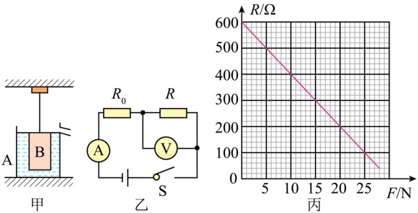

# Physics - 题目 1389

**ID**: d21fda241a86405db459e26fc3ad0a05
**年级**: Grade 9
**难度**: Hard
**题型**: Calculation

## 题目
小杜为了测量不同饮料的密度，设计了如图甲所示的装置。​​​​​​​‌A是家中常用的轻质塑料溢水杯，圆柱体B是一个材质均匀的金属块，质量为 $3{\rm{k}}{\rm{g}}$ ，用细线与力敏传感器R相连，R的阻值随拉力的变化图像如图丙所示，B的上表面与溢水口相平；图乙是R所在的电路，电源电压 ${\rm \mathit{U}=6V，}R{{}_{0}}=100\Omega $ 电压表量程为“0～5V”，电流表量程为“0～0.03A”。向溢水杯中加满水，电流表示数为 $0.02{\rm{A}}$ 。求：（1）此时电阻R的阻值；（2）金属块（圆柱体B）的密度；（3）为了能测量更多种类饮料的密度，小杜在其余部分不改动的前提下，更换定值电阻 $R{{}_{0}}$ 为 $R{{}_{x}}$ ，再次将溢水杯中装满水，此时电流表示数为 $I{{}_{1}}$ ；将溢水杯中的水换为已知密度为 $1.8\times 10{^{3}}{\rm{k}}{\rm{g}}/{\rm{m}}{^{3}}$ 的一种饮料时（仍装满），电流表的示数为 $I{{}_{2}}$ ；若 $I{{}_{1}}:I{{}_{2}}=3:2$ ，求该装置调整后能测量的饮料密度范围。

## 解答

1. （1）据乙图可知，电路为两电阻串联，当电路中的电流为0.02A时，电路中的总电阻为 $R=\frac {U}{I}=\frac {6{\rm{V}}}{0.02{\rm{A}}}=300{\rm{Ω}}$ ，此时电阻 $R$ 的阻值为 $R=R{{}_{总}}-R{{}_{0}}=300{\rm{Ω}}-100{\rm{Ω}}=200{\rm{Ω}}$
2. （2）据丙图可知，此时力敏传感器受到的拉力为20N，金属块的重力为 $G=m{{}_{金属}}g=3{\rm{k}}{\rm{g}}\times 10{\rm{N}}/{\rm{k}}{\rm{g}}=30{\rm{N}}$ ，金属块受到的浮力为 $F{{}_{浮}}=G-F=30{\rm{N}}-20{\rm{N}}=10{\rm{N}}$ ，此时金属块排开液体的体积等于金属块的体积为，可得金属块的体积为 $V{{}_{{\rm{B}}}}=V{{}_{排{\rm{B}}}}=\frac {F{{}_{浮}}}{ρ{{}_{水}}g}=\frac {10{\rm{N}}}{10{^{3}}{\rm{k}}{\rm{g}}/{\rm{m}}{^{3}}\times 10{\rm{N}}/{\rm{k}}{\rm{g}}}=10{^{-3}}{\rm{m}}{^{3}}{\rm{=}}1000{\rm{c}}{\rm{m}}{^{3}}$ ， $ρ{{}_{金属}}=\frac {m{{}_{金属}}}{V{{}_{金属}}}=\frac {300{\rm{g}}}{1000{\rm{c}}{\rm{m}}{^{3}}}=3{\rm{g}}/{\rm{c}}{\rm{m}}{^{3}}$
3. （3）圆柱体B浸没在另一液体中受到的浮力 $F{{}_{浮}}{^{^{′}}}=ρ{{}_{液}}gV{{}_{排B}}=1.8\times 10{^{3}}{\rm{k}}{\rm{g}}/{\rm{m}}{^{3}}\times 10{\rm{N}}/{\rm{k}}{\rm{g}}\times 10{^{-2}}{\rm{m}}{^{3}}=18{\rm{N}}$ ，此时的拉力为 $F^{′}=G-F{{}_{浮}}{^{^{′}}}=30{\rm{N}}-18{\rm{N}}=12{\rm{N}}$ ，由表可知此时力敏电阻的阻值R'=360Ω，电源电压为 $U=I{{}_{1}}\left ({R{{}_{x}}+R}\right )=I{{}_{2}}\left ({R{{}_{x}}+R^{′}}\right )$ ，已知 $I{{}_{1}}:I{{}_{2}}=3:2$ ，可得 $\frac {I{{}_{1}}}{I{{}_{2}}}=\frac {\left ({R{{}_{x}}+R^{′}}\right )}{\left ({R{{}_{x}}+R}\right )}=\frac {R{{}_{x}}+360{\rm{Ω}}}{R{{}_{x}}+200{\rm{Ω}}}=\frac {3}{2}$ ，解得R_{x}=120Ω；当电压表示数U_{0}=5V时，此时测量液体的密度最大，由串联电路电压的分配与电阻成正比得 $\frac {U{{}_{0}}}{U-U{{}_{0}}}=\frac {R^{′}}{R{{}_{x}}}$ ，代入数据后得 $\frac {5{\rm{V}}}{6{\rm{V}}-5{\rm{V}}}=\frac {R^{′}}{120{\rm{Ω}}}$ ，解得 $R^{′}=600{\rm{Ω}}$ ，所以此时拉力为0N，此时 $F{{}_{浮2}}=G=30{\rm{N}}$ ，故最大密度为 $ρ{{}_{液\max }}=\frac {F{{}_{浮2}}}{gV{{}_{{\rm{B}}}}}=\frac {30{\rm{N}}}{10{\rm{N}}/{\rm{k}}{\rm{g}}\times 10{^{-3}}{\rm{m}}{^{3}}}=3\times 10{^{3}}{\rm{k}}{\rm{g}}/{\rm{m}}{^{3}}=3{\rm{g}}/{\rm{c}}{\rm{m}}{^{3}}$ ，密度的最小值为R最小时，此时电路中电流最大为0.03A，可得 $R^{′′}=\frac {U}{I{{}_{\max }}}-R{{}_{x}}=\frac {6{\rm{V}}}{0.03{\rm{A}}}-120{\rm{Ω}}=80{\rm{Ω}}$ ，据图可知，对应的拉力F_{2}=26N，金属块受到的浮力为 $F{{}_{浮3}}=G-F{{}_{2}}=30{\rm{N}}-26{\rm{N}}=4{\rm{N}}$ ，液体的最小密度为 $ρ{{}_{液\min }}=\frac {F{{}_{浮3}}}{gV{{}_{{\rm{B}}}}}=\frac {4{\rm{N}}}{10{\rm{N}}/{\rm{k}}{\rm{g}}\times 10{^{-3}}{\rm{m}}{^{3}}}=0.4\times 10{^{3}}{\rm{k}}{\rm{g}}/{\rm{m}}{^{3}}=0.4{\rm{g}}/{\rm{c}}{\rm{m}}{^{3}}$ ，该装置调整后能测量的饮料密度范围为 $0.4{\rm{g}}/{\rm{c}}{\rm{m}}{^{3}}⩽ρ{{}_{液}}⩽3{\rm{g}}/{\rm{c}}{\rm{m}}{^{3}}$

## 知识点

**中文**:
  - 欧姆定律的应用
  - 阿基米德原理的应用
  - 电路的动态分析

**English**:
  - Applications of Ohm's Law
  - Applications of Archimedes' Principle
  - Dynamic Circuit Analysis

---
