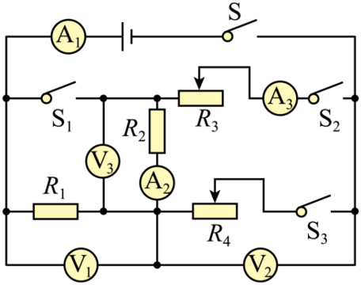

# Physics - 题目 2082

**ID**: edfe2513f56046a89ef3545acc5b2b0e
**年级**: Grade 9
**难度**: Hard
**题型**: Calculation

## 题目
在如图所示的电路中，电源电压保持不变，电路都采用学生用电压表和电流表。​​​​​​​‌只闭合S、  ${\rm{S}}{{}_{3}}，R{{}_{4}}$ 滑片移到最左端时，电压表  ${\rm{V}}{{}_{{{1}}}}$ 的示数为12V； 只闭合S、S_{1}、 ${\rm S_{3}，}R{{}_{4}}$ 滑片移到最左端时，电流表 ${\rm{A}}{{}_{{{1}}}}$ 的示数为1.6A，电流表 ${\rm{A}}{{}_{{{2}}}}$ 的示数为0.6A。（1）电源电压为多少？（2）只闭合S、  ${\rm{S}}{{}_{{{1}}}}、{\rm{S}}{{}_{{{3}}}}，R{{}_{4}}$ 滑片移到最左端时，通过 $R{{}_{1}}$ 的电流是多少？（3）闭合所有开关，  $R{{}_{3}}$ 滑片移到最右端，  $R₄$ 滑片移到最左端，电流表  ${\rm{A}}{{}_{{{1}}}}$ 和  ${\rm{A}}{{}_{{{3}}}}$ 的偏转角度相同； 断开所有开关，将电压表  ${\rm{V}}{{}_{{{3}}}}$ 和电流表 ${\rm{A}}{{}_{{{2}}}}$ 互换，再闭合所有开关，将。 $R{{}_{3}}$ 和  $R{{}_{4}}$ 滑片都移到最右端，电流表 ${\rm{A}}{{}_{{{1}}}}$ 的偏转角度是电流表 ${\rm{A}}₃$ 的 $\frac {1}{4}$ ，此时通过 $R₄$ 的电流是多少？

## 解答

1. （1）只闭合S、S_{3}，R_{4}滑片移到最左端时，R_{4}接入阻值为0，电路是R_{1}的简单电路，电压表V_{1}测的是电源电压，故电源电压为12V。
2. （2）只闭合S、S_{1}、 S_{3}，R_{4}滑片移到最左端时，R_{4}接入阻值为0，电路是R_{1}与R_{2}的并联电路，电流表A_{1}测干路电流为1.6A，电流表A_{2}测通过R_{2}的电流为0.6A，故通过 $R₁$ 的电流是 $I{{}_{1}}=1.6{\rm{A}}-0.6{\rm{A}}=1{\rm{A}}$
3. （3）闭合所有开关，R_{3}滑片移到最右端，R_{4}滑片移到最左端，R_{4}接入阻值为0，电路是R_{1}、R_{2}和R_{3}的并联电路，电流表A_{1}测干路电流，电流表A_{2}测通过R_{2}的电流，电流表A_{3}测通过R_{3}的电流，电流表A_{1}和A_{3}的偏转角度相同，则A_{1}选用的是0~3A量程，A_{3}选用的是0~0.6A量程，且A_{1}的示数是A_{3}的5倍，即 $I{{}_{{\rm{A}}{{}_{1}}}}=5I{{}_{{\rm{A}}{{}_{3}}}}$ ，因为当电路是R_{1}与R_{2}的并联电路，电流表A_{1}测干路电流为1.6A，电源电压保持不变，由并联电路电流规律可知 $I{{}_{{\rm{A}}{{}_{1}}}}=I{{}_{{\rm{A}}{{}_{3}}}}+1.6{\rm{A}}$ ，综上得 $I{{}_{{\rm{A}}{{}_{3}}}}=0.4{\rm{A}}$ ；断开所有开关，将电压表V_{3}和电流表A_{2}互换，再闭合所有开关，将R_{3}和R_{4}滑片都移到最右端，R_{3}和R_{4}都接入最大阻值，此时R_{1}被短接，电路是R_{3}与R_{3}的并联电路，A_{1}测干路电流，A_{2}测通过R_{4}的电流，A_{3}测通过R_{3}的电流，此时电流表A_{1}的偏转角度是电流表A_{3}的 $\frac {1}{4}$ ，则此时A_{1}示数是A_{3}的 $\frac {5}{4}$ 倍，即 $I{{}_{{\rm{A}}{{}_{1}}}^{^{′}}}=\frac {5}{4}I{{}_{{\rm{A}}{{}_{3}}}^{^{′}}}$ ，电源电压保持不变，故 $I{{}_{{\rm{A}}{{}_{3}}}^{^{′}}}=I{{}_{{\rm{A}}{{}_{3}}}}=0.4{\rm{A}}$ ，由并联电路电流规律可知，此时通过 $R{{}_{4}}$ 的电流为 $I{{}_{R{{}_{4}}}}=I{{}_{{\rm{A}}{{}_{1}}}^{^{′}}}-I{{}_{{\rm{A}}{{}_{3}}}^{^{′}}}=\frac {1}{4}I{{}_{{\rm{A}}{{}_{3}}}^{^{′}}}=\frac {1}{4}\times 0.4{\rm{A}}=0.1{\rm{A}}$

## 知识点

**中文**:
  - 与欧姆定律有关的动态电路计算

**English**:
  - Calculations in Dynamic Circuits using Ohm's Law

---
