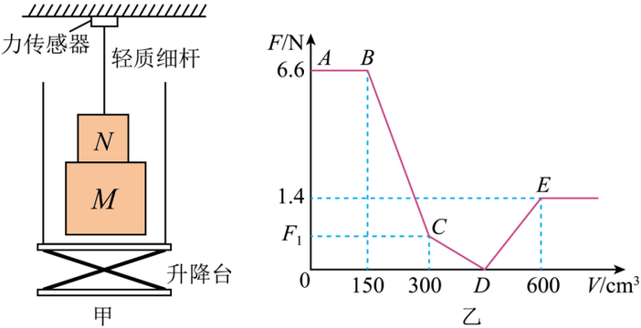

# Physics - 题目 1701

**ID**: f9b5b3bd93e6417cac60d2d3d437741e
**年级**: Grade 9
**难度**: Hard
**题型**: Calculation

## 题目
在科技节来临之际，物理科技创新小组利用力传感器（力传感器可以显示出轻质细杆上端受到的作用力大小）设计了如图甲所示的装置，足够高的圆柱形容器的底面积为50cm^{2}，容器放在升降台上，容器正上方的天花板上用轻质细杆（体积忽略不计）连接力传感器，细杆下端黏合着由两个横截面积不同、材料相同且不吸水的实心圆柱体M、N组成的物体，且M物体的高度 $h{{}_{M}}=15{\rm{c}}{\rm{m}}$ 。​​​​​​​‌缓慢向容器中注水，容器中水量多少与轻质细杆上端所受的作用力大小之间的关系如图乙所示，根据相关信息， $ρ{{}_{水}}=1.0\times 10{^{3}}{\rm{k}}{\rm{g}}{\rm{/}}{\rm{m}}{^{{{3}}}}{\rm ，\mathit{g}}$ 取10N/kg。求：（1）该组合物体的重力；（2）该组合物体材料的密度；（3）当力传感器显示的示数为3F_{1}时，用升降台将容器向上移动3cm，然后将细杆撤去，待水面稳定后，此时水对容器底的压强。

## 解答

1. 解：（1）由图乙可知，未加入水时，M与N整体仅受重力G和杆的拉力 $F{{}_{拉}}=6.6{\rm{N}}$ ，依据平衡条件可得，M与N的总重力 $G=F{{}_{拉}}=6.6{\rm{N}}$ ；
2. （2）根据图乙可知，A~B为水未接触到M时，B~C为水刚接触到M到完全浸没M时，C~D为水刚接触到N到M与N受到的浮力恰好等于总重力，D~E为水一直加到容器满，因此放满水后，M与N整体受到重力G和杆竖直向下的弹力以及竖直向上的浮力，
3. 由受力分析知，浮力 $F{{}_{浮}}=G+F{{}_{压}}=6.6{\rm{N}}+1.4{\rm{N}}=8{\rm{N}}{\rm ，\mathit{M}}$ 与N的总体积等于浸在水中的体积，即等于排开水的体积， $V{{}_{MN}}=V{{}_{排}}=\frac {F{{}_{浮}}}{ρ{{}_{水}}g}=\frac {8{\rm{N}}}{1\times 10{^{3}}{{\rm{k}}{\rm{g}}}/{{\rm{m}}{^{3}}\times 10{{\rm{N}}}/{{\rm{k}}{\rm{g}}}}}=8\times 10{^{-4}}{\rm{m}}{^{3}}$ ，则该组合物体材料的密度 $ρ=\frac {m{{}_{MN}}}{V{{}_{MN}}}=\frac {G}{V{{}_{MN}}g}=\frac {6.6{\rm{N}}}{8\times 10{^{-4}}{\rm{m}}{^{3}}\times 10{{\rm{N}}}/{{\rm{k}}{\rm{g}}}}=0.825\times 10{^{3}}{{\rm{k}}{\rm{g}}}/{{\rm{m}}{^{3}}}$ ；
4. （3）由上述分析可知，A~B为水未接触到M时，B点时注入水的体积为150cm^{3}，容器底部的面积为50cm^{2}，则水的深度 $h{{}_{M下}}=\frac {V{{}_{水{{1}}}}}{S{{}_{容}}}=\frac {150{\rm{c}}{\rm{m}}{^{3}}}{50{\rm{c}}{\rm{m}}{^{2}}}=3{\rm{c}}{\rm{m}}$ ；
5. B~C为水刚接触到M到完全浸没M时，C点时注入水的体积为300cm^{3}，则M的底面积 $S{{}_{M}}=50{\rm{c}}{\rm{m}}{^{2}}-\frac {300{\rm{c}}{\rm{m}}{^{3}}-150{\rm{c}}{\rm{m}}{^{3}}}{15{\rm{c}}{\rm{m}}}{\rm{=}}{{4}}{{0}}{\rm{c}}{\rm{m}}{^{2}}$ ，则在C点时，物体M浸没的体积 $V{{}_{M}}=40{\rm{c}}{\rm{m}}{^{{{2}}}}\times 15{\rm{c}}{\rm{m}}=600{\rm{c}}{\rm{m}}{^{{{3}}}}=6\times 10{^{-4}}{\rm{m}}{^{{{3}}}}$ ，此时M与N受到的浮力 $F{{}_{浮}}{{}_{C}}=ρ{{}_{水}}V{{}_{M}}g=1.0\times 10{^{3}}{\rm{k}}{\rm{g}}{\rm{/}}{\rm{m}}{^{{{3}}}}\times 6\times 10{^{-4}}{\rm{m}}{^{{{3}}}}\times 10{\rm{N}}{\rm{/}}{\rm{k}}{\rm{g}}=6{\rm{N}}$ ，此时M与N整体受到重力G和杆竖直向上的弹力以及竖直向上的浮力，由受力分析知， $F{{}_{1}}=G-F{{}_{浮}}{{}_{1}}=6.6{\rm{N}}-6{\rm{N}}=0.6{\rm{N}}$ ；
6. 当力传感器显示的示数为3F_{1}时， $F{{}_{2}}=3F{{}_{1}}=3\times 0.6{\rm{N}}=1.8{\rm{N}}$ ，则此时M与N受到的浮力 $F{{}_{浮}}{{}_{2}}=G-F{{}_{2}}=6.6{\rm{N}}-1.8{\rm{N}}=4.8{\rm{N}}$ ，此时物体M排开水的体积 $V{{}_{M{{2}}}}=V{{}_{排2}}=\frac {F{{}_{浮2}}}{ρ{{}_{水}}g}=\frac {4.8{\rm{N}}}{1\times 10{^{3}}{{\rm{k}}{\rm{g}}}/{{\rm{m}}{^{3}}\times 10{{\rm{N}}}/{{\rm{k}}{\rm{g}}}}}=4.8\times 10{^{-4}}{\rm{m}}{^{3}}=480{\rm{c}}{\rm{m}}{^{3}}{\rm ，\mathit{M}}$ 浸入的深度 $h{{}_{M浸}}=\frac {V{{}_{M{{2}}}}}{S{{}_{M}}}=\frac {480{\rm{c}}{\rm{m}}{^{3}}}{40{\rm{c}}{\rm{m}}{^{2}}}=12{\rm{c}}{\rm{m}}$ ，故当弹簧测力计的示数为3F_{1}时，容器中水的体积 $V{{}_{水}}=150{\rm{c}}{\rm{m}}{^{{{3}}}}+\left ({50{\rm{c}}{\rm{m}}{^{{{2}}}}-40{\rm{c}}{\rm{m}}{^{{{2}}}}}\right )\times 12{\rm{c}}{\rm{m}}=270{\rm{c}}{\rm{m}}{^{{{3}}}}$ ，
7. 由图乙可知，从C到E，水面从N下表面到容器口，浮力的变化量 $ΔF{{}_{浮}}=1.4{\rm{N}}+0.6{\rm{N}}=2{\rm{N}}{\rm ，\mathit{N}}$ 的体积等于排开水增加的体积 $V{{}_{N}}=V{{}_{排3}}=\frac {ΔF{{}_{浮}}}{ρ{{}_{水}}g}=\frac {2{\rm{N}}}{1\times 10{^{3}}{{\rm{k}}{\rm{g}}}/{{\rm{m}}{^{3}}\times 10{{\rm{N}}}/{{\rm{k}}{\rm{g}}}}}=2\times 10{^{-4}}{\rm{m}}{^{3}}=200{\rm{c}}{\rm{m}}{^{3}}$ ，故N的高度 $h{{}_{N}}=\frac {V{{}_{N}}+300{\rm{c}}{\rm{m}}{^{3}}}{S{{}_{容}}}=\frac {200{\rm{c}}{\rm{m}}{^{3}}+300{\rm{c}}{\rm{m}}{^{3}}}{50{\rm{c}}{\rm{m}}{^{2}}}=10{\rm{c}}{\rm{m}}{\rm ，\mathit{N}}$ 的底面积 $S{{}_{N}}=\frac {V{{}_{N}}}{h{{}_{N}}}=\frac {200{\rm{c}}{\rm{m}}{^{3}}}{10{\rm{c}}{\rm{m}}}{\rm{=}}{{2}}{{0}}{\rm{c}}{\rm{m}}{^{2}}$ ；
8. 当容器向上移动3cm时，水的深度 $h=h{{}_{M}}+\frac {V{{}_{水}}-150{\rm{c}}{\rm{m}}{^{3}}}{S-S{{}_{N}}}=15{\rm{c}}{\rm{m}}+\frac {270{\rm{c}}{\rm{m}}{^{3}}-150{\rm{c}}{\rm{m}}{^{3}}}{50{\rm{c}}{\rm{m}}{^{2}}-20{\rm{c}}{\rm{m}}{^{2}}}=19{\rm{c}}{\rm{m}}{\rm ，\mathit{N}}$ 浸入的深度 $h{{}_{N}}=\frac {V{{}_{水}}-150{\rm{c}}{\rm{m}}{^{3}}}{S-S{{}_{N}}}=\frac {270{\rm{c}}{\rm{m}}{^{3}}-150{\rm{c}}{\rm{m}}{^{3}}}{30{\rm{c}}{\rm{m}}{^{2}}}=4{\rm{c}}{\rm{m}}$ ，排开液体的体积 $V{{}_{排}}{{}_{4}}=V{{}_{M}}+S{{}_{N}}h{{}_{N}}=600{\rm{c}}{\rm{m}}{^{{{3}}}}+20{\rm{c}}{\rm{m}}{^{{{2}}}}\times 4{\rm{c}}{\rm{m}}=680{\rm{c}}{\rm{m}}{^{{{3}}}}$ ；
9. 漂浮时，浮力等于重力，即 $F{{}_{浮}}{{}_{4}}=G=6.6{\rm{N}}$ ，排开水的体积 $V{{}_{排4}}=\frac {F{{}_{浮4}}}{ρ{{}_{水}}g}=\frac {6.6{\rm{N}}}{1\times 10{^{3}}{{\rm{k}}{\rm{g}}}/{{\rm{m}}{^{3}}\times 10{{\rm{N}}}/{{\rm{k}}{\rm{g}}}}}=6.6\times 10{^{-4}}{\rm{m}}{^{3}}=660{\rm{c}}{\rm{m}}{^{3}}$ ，故撤去杆后，MN漂浮，稳定后，水对容器底的压力 $F{{}_{压}}=G{{}_{水}}+G{{}_{MN}}=m{{}_{水}}g+G{{}_{MN}}=ρ{{}_{水}}V{{}_{水}}g+G{{}_{MN}}=1\times 10{^{3}}{\rm{k}}{\rm{g}}{\rm{/}}{\rm{m}}{^{{{3}}}}\times 270\times 10{^{-6}}{\rm{m}}{^{{{3}}}}\times 10{\rm{N}}{\rm{/}}{\rm{k}}{\rm{g}}+6.6{\rm{N}}=9.3{\rm{N}}$ ，水对容器底的压强 $p=\frac {F{{}_{压}}}{S{{}_{容}}}=\frac {9.3{\rm{N}}}{50\times 10{^{-4}}{\rm{m}}{^{2}}}=1860{\rm{P}}{\rm{a}}$ 。
10. 答：（1）该组合物体的重力为6.6N；
11. （2）该组合物体材料的密度为0.825×10^{3}kg/m^{3}；
12. （3）水对容器底的压强为1860Pa。

## 知识点

**中文**:
  - 密度、压强和浮力的综合

**English**:
  - Integrated Density, Pressure, and Buoyancy

---
