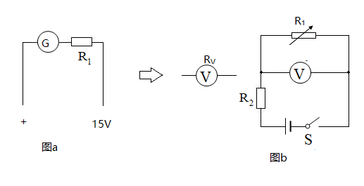

# Physics - 题目 43

**ID**: fb60b791b54e415b99c609ab636edc96
**年级**: Grade 9
**难度**: Hard
**题型**: Calculation

## 题目
已知电流表G的满偏电流（即电流表指针偏转到最大刻度时的电流）为1mA，内阻600Ω，现将其与一定值电阻R_{1}串联改装成量程为15V的电压表，如图a所示。​​​​​​​‌(1)求电流表G指针满偏时，它两端电压为多少？(2)求改装后的电压表电阻R_{V}的大小；(3)如图b所示，将改装后的电压表接入电路，电源电压15V不变，电阻R_{2}=6000Ω，改变接入的可变电阻大小，使电压表示数为5V，求此时可变电阻大小以及加在电压表内部表头G两端的电压。

## 解答

1. (1) 由 $I=\frac {U}{R}$ 得，电流表的满偏电压为
2. $U{{}_{{\rm{g}}}}=I{{}_{{\rm{g}}}}R{{}_{{\rm{g}}}}=0.001{\rm{A}}\times 600{\rm{Ω}}{\rm{=}}0.6{\rm{V}}$
3. (2)改装后的电压表电阻R_{V}的大小为
4. $R{{}_{{\rm{V}}}}=\frac {U}{I{{}_{{\rm{g}}}}}=\frac {15{\rm{V}}}{0.001{\rm{A}}}=1.5\times 10{^{4}}{\rm{Ω}}$
5. (3)由如图b可知，R_{V}与R_{1}并联后再与R_{2}串联，此时电压表的示数U_{1}=5V，则电压表和R_{1}两端电压均为5V，此时通过电压表的电流
6. $I{{}_{{\rm{V}}}}=\frac {U{{}_{1}}}{R{{}_{{\rm{V}}}}}=\frac {5{\rm{V}}}{1.5\times 10{^{4}}{\rm{Ω}}}=\frac {1}{3000}{\rm{A}}$
7. 电阻R_{2}两端的电压
8. $U{{}_{2}}=U-U{{}_{1}}={\rm{1}}{\rm{5}}{\rm{V}}{\rm{-}}{\rm{5}}{\rm{V}}{\rm{=}}{\rm{1}}{\rm{0}}{\rm{V}}$
9. 通过R_{2}的电流即干路电流为
10. $I=\frac {U{{}_{2}}}{R{{}_{2}}}=\frac {10{\rm{V}}}{6000{\rm{Ω}}}=\frac {1}{600}{\rm{A}}$
11. 则通过可变电阻R_{1}的电流为
12. $I{{}_{1}}=I-I{{}_{{\rm{V}}}}=\frac {1}{600}{\rm{A}}{\rm{-}}\frac {1}{3000}{\rm{A}}=\frac {1}{750}{\rm{A}}$
13. 此时可变电阻R_{1}的阻值为
14. $R{{}_{1}}=\frac {U{{}_{1}}}{I{{}_{1}}}=\frac {{\rm{5}}{\rm{V}}}{\frac {1}{750}{\rm{A}}}=3750{\rm{Ω}}$
15. 则原电流计G两端的电压
16. $U{{}_{{\rm{g}}}^{^{′}}}=I{{}_{{\rm{V}}}}R{{}_{{\rm{g}}}}=\frac {1}{3000}{\rm{A}}\times 600{\rm{Ω}}=0.2{\rm{V}}$
17. 答：(1)求电流表G指针满偏时，它两端电压为0.6V；
18. (2)改装后的电压表电阻R_{V}的大小为1.5×10^{4}Ω；
19. (3)可变电阻大小为3750Ω，加在电压表内部表头G两端的电压0.2V。

## 知识点

**中文**:
  - 串联电路的电压规律
  - 并联电路的电流规律
  - 欧姆定律的应用

**English**:
  - Voltage Law in Series Circuits
  - Current Law in Parallel Circuits
  - Applications of Ohm's Law

---
